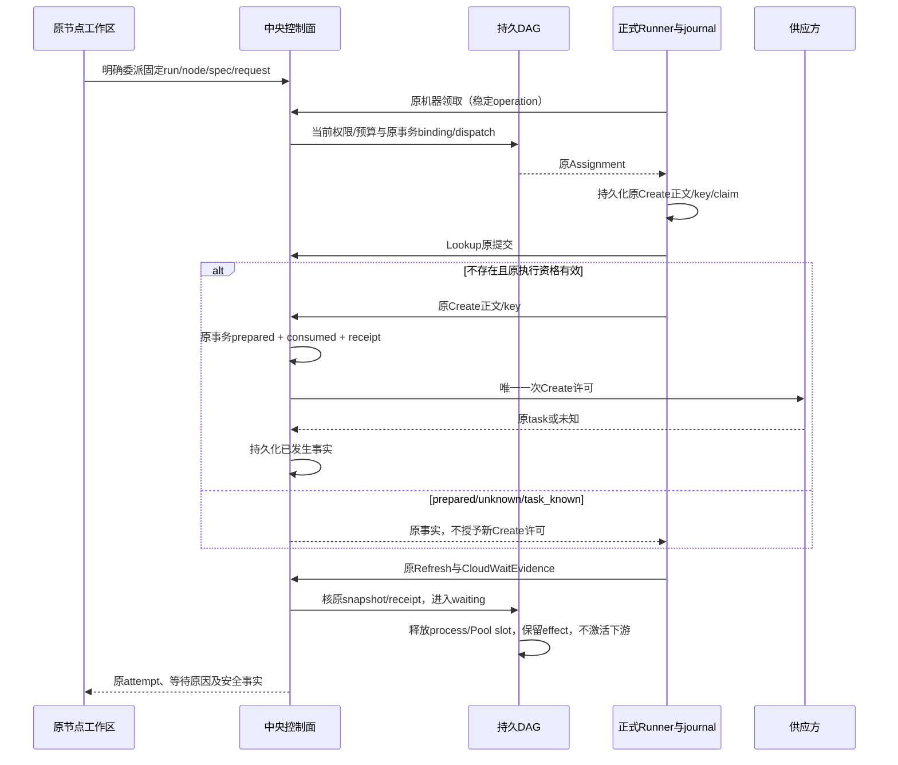

# 云执行的正式调度、持久恢复与效果核对

版本1.0.0；阶段T-WORKBUDDY-RUNNER-155；负责人：主集成代理；状态：Windows／SQLite限定验收通过。关联：[需求](../product/workbuddy-cloud-runner.md)、[合同](../../contracts/workbuddy-cloud-runner.md)、[152中央创建架构](workbuddy-cloud-execution.md)、[验收证据与边界](../quality/workbuddy-cloud-runner-verification.md)。

## 边界与数据流

| 模块 | 职责与边界 |
| --- | --- |
| Go DAG | 原事务领取、尝试、租约、资源、结果和后继激活；不访问供应方 |
| claim authority | 一次锁定机器与全部owner，核当前组织、项目、Pool、委派和预算；不伪造Actor，不在run锁后补身份锁 |
| 中央连接域 | 固定授权、单次prepared外发许可、准确提交及观察；prepared/unknown不能重建许可 |
| 正式Worker | 领取、心跳、checkpoint、原请求恢复、进度和outbox；不持供应方凭据，不直连创建 |
| trusted resolver | 原机器结果事务内核原快照、委派、提交和Create receipt；不获取新执行权限，不解密或联网 |
| 节点工作区 | 投影正式Run/Node与安全提交；不自行派发或验收 |

## 固定身份与存储

`CloudAssignmentBinding`固定委派ID、领取版本及不可变授权摘要。合法消费v1→v2不改变原binding；只有同一原assignment的提交可以解释消费。SHA排除state、consumed和更新时间，当前权利另行重验。

`dag_external_assignments`以tenant/project/run/node/attempt为主键，唯一约束dispatch ID，保存fence、worker、protocol、binding及原AssignmentRef/SHA，反向核对原dispatch。私有Ref仅含run/node/attempt/fence/worker；Pool Ref保留完整双边scope及原lease/state。心跳不覆写原Ref。表中无prompt或秘密。初始化在任何DDL之前验证完整初始schema，残缺或旧布局明确拒绝，不backfill、reset或迁移用户数据库。

## 恢复、等待和取消

lookup只读原事实，不创建操作回执、不变更预算或访问供应方。同attempt租约过期或委派墓碑可以读取原事实，但不会恢复执行权；当前owner、机器、凭据摘要和Pool双边版本仍须核对。Create/Refresh继续要求有效执行资格。

checkpoint及outbox各自保留原操作身份。创建未知只恢复同正文/key；prepared/unknown不重复外发。刷新ACK未知时，后来的观察不能冒充原ACK。已经写入正式等待结果的本机记录只重传原结果，不再声称持续后台执行。

内核复用`waiting`，由中央已存事实决定原因。completed对应`cloud.delivery_required`；lease失联对应`cloud.runner_disconnected`；取消但远端未核实对应`cloud.stop_unconfirmed`。等待保留attempt/fence/worker，完成时间为空，释放process和Pool slot，保留effect。机器不能自报成功、远端停止或没有执行。

只有原提交不存在且consumed=0，才能在同一机器/组织/run锁下确认未创建。节点离开running与核对原子提交，迟到Create不能取得许可；consumed=1但无记录是完整性冲突。原Create receipt还核凭据摘要、准确body/key和submission ID。旧观察版本可证明原身份，不覆盖中央较新事实。

参考Multica统一执行节点和简化工作区交互，沿已锁定参考提交及许可清单；本阶段没有复制受限制的托管或品牌实现。复用已有Go DAG、Runner、SQLite事务、机器权限、journal/outbox、React/React Flow及152供应方SDK，不增加第二调度器或vendor Create路径。云候选、机器ACP、独立测试及正式验收继续完整目标。
