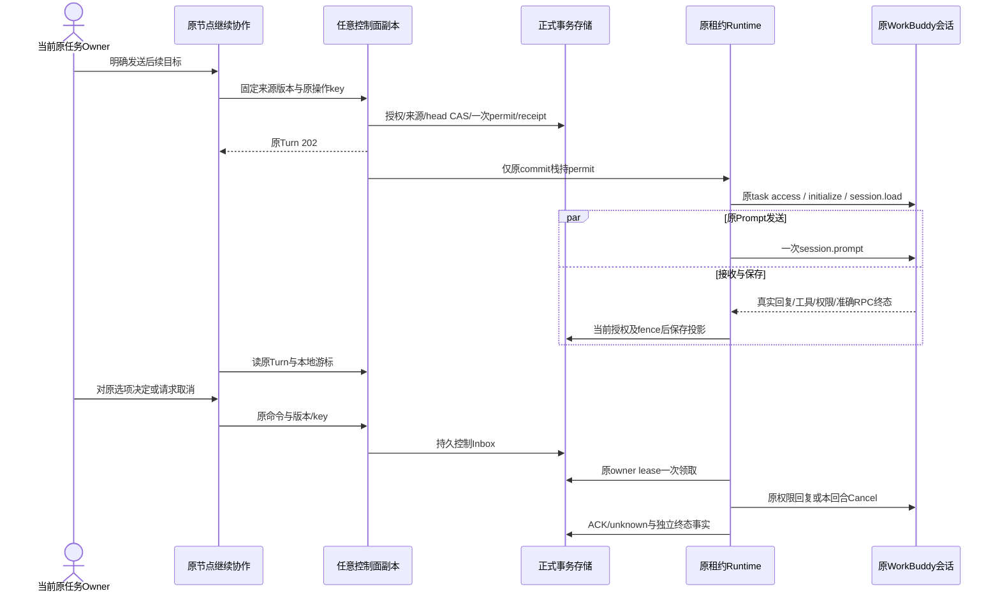

# 原云任务持续协作：架构与 AI SOP

状态：T-WORKBUDDY-CLOUD-TURNS-169限定实现及验证，实际覆盖见[阶段证据](../quality/workbuddy-cloud-turns-verification.md)；负责人：主集成／控制面／运行时／工作台；suma 1.0.0；2026-10-31。需求：原任务持续输入、真实回复、准确权限决定、取消及异常恢复，关联[统一合同](../../contracts/workbuddy-cloud-turns.md)和[原任务派发](workbuddy-task-dispatch.md)。完整31／P0–P7目标不因局部能力关闭。

## 参考与复用边界

本轮延续本地Multica固定提交`e8ae72c9dfc1b4474b61a9087f51b33cbee6a048`的任务上下文、持续协作及渐进展示参考，并复用速码既有DAG、身份、工作区、操作回执和设计令牌。协议采用`github.com/coder/acp-go-sdk v0.13.5`及已有WorkBuddy传输；Multica当前附加许可条件下的适配源码未进入本轮代码，具体第三方采用方式继续由[参考能力矩阵](../product/reference-platform-parity.md)及[既有SDK许可清单](../delivery/workbuddy-acp-dependencies.json)追溯。

## 领域与职责

`CloudTurn`是原已知云任务上的一次明确人机交互，不是新的业务任务、Runner attempt或云Create。来源绑定正式submission、task、node、原assignment／fence及摘要。`CloudTurnPermission`是供应方原权限请求的有界、安全投影；`CloudTurnCommand`是原回合上一次可追溯控制意图。租约、inbox、工具账本和回复均属于事务数据，SSE本身不是正式状态库。

原Go DAG保留平台任务派发权。控制面只在本人明确发送后、数据库commit成功的原调用栈取得一个不可重建的runtime permit；后续Prompt／Next处理原会话。重放202、打开页面、读存档及恢复HTTP回执都不能构造另一个运行permit。服务重启不能自动Attach、再发Prompt或恢复旧权限引用。

## 分布式一致性

head串行化同一原submission；未知回合继续阻塞该head，不阻塞独立任务。当前owner、组织／项目、原attempt和grant、预算先于网络外发核对。取得组织／项目协调后才进入领域行，禁止反向补锁；网络I/O不占数据库事务。独立本地sequence与语义版本分开，持续文本不应使人确认权限时不断遭遇无关CAS冲突。

所有副本都能写控制inbox，只有原lease/fence runtime领取一次。状态prepared表示正式意图已保存，sent表示唯一原发送permit已使用，acknowledged也只证明该HTTP结果；unknown不自动重发。租约到期或进程退出时保留不确定效果；reconcile只封存unknown和增加fence，不制造远端停止或下一次Prompt资格。

当前节点waiting是原Runner排空后的事实。本人的新回合形成独立有限授权，不能续造旧Runner租约或恢复Create额度。原Run、node、业务验收和可信代码候选不因assistant文字／RPC end_turn变更。已发送后撤权仍须留下本次终态或unknown事实，访问正文仍按当前权限拒绝。

## 内容、权限及计量

仅保存文本、工具状态、计划摘要和安全分类，不存thought、原始packet、artifact URI或临时连接材料。已知凭据在持久化前脱敏，流式处理保留必要尾部以跨chunk识别秘密；超限、无法安全处理及缺失来源都保留未核实事实，不能截断后显示完整成功。

权限只对供应方实际请求生效，SDK声明客户端文件与terminal能力为false。完整安全细节及准确原选项才能进行本次允许；无法展示完整依据时只允许拒绝。本阶段不授予always权限，不将允许转换为项目角色或持久工具白名单。Cancel针对本连接本次主动Prompt，Close只停止本地连接。

usage缺失保持unreported；已报告计数仍为partial，不补零、不把上下文窗口used／size、供应方credit或取消ACK当作已定价账单。组织／项目enforce预算仍拒绝此观测执行能力，模型选择由供应方控制，不能在界面提供虚假平台模型覆盖。

## AI 开发 SOP

1. 读取完整原目标、当前状态和本合同。主集成维护公共DTO／生成器／全局接线；后端和runtime先冻结内部permit接口，再各自修改分配文件。
2. 先落实正式事务、当前授权和原请求恢复，再接成熟SDK。保持Prompt HTTP发送与Next接收并行，避免供应方等待权限回执时死锁。
3. 每条记录保存明确来源，按tool_call_id维护终结账本；原RPC结束、未终结工具、权限及控制命令分别核对。
4. 界面只把原本人回合当私有协作，公开节点读权与私有拒绝分开。关闭composer不卸载writer，不把revision或submission观察版本当组件身份。
5. 定向检查权限、once/fence、两副本inbox、断线／重启、死锁、取消与秘密跨chunk。未变成功结果复用，不重复收费模型或无关全套。
6. 源码、受控协议、真实本机HTTP／GUI、真实供应方及生产分层留证。阶段完整后commit并正常push dev，只交付必要源码与设计／证据；缓存和私有原文保持忽略。
