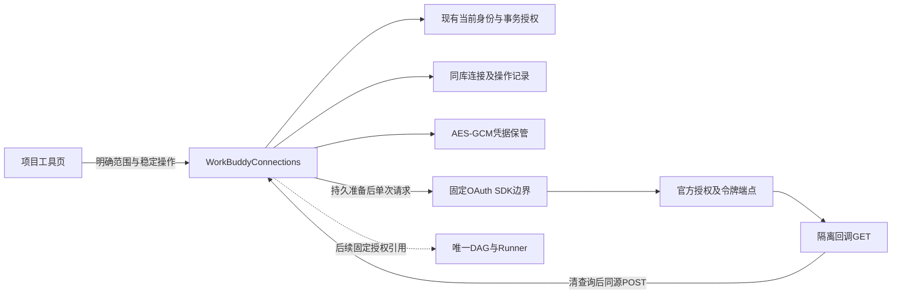

# WorkBuddy授权连接的模块与恢复边界

T-WORKBUDDY-CONNECTIONS-147；速码1.0.0。[领域合同](../../contracts/workbuddy-connections.md)是本模块的接口和状态约束，完整交付继续沿[实施计划](../delivery/implementation-plan.md)。本模块使用户能授权、查看、刷新和本地断开WorkBuddy连接；云执行仍沿143向后续ACP、预算和候选门禁推进。

## 唯一状态所有权

新组件组合原`Service`，不复制平台用户、组织、项目、授权或业务任务。`suma_workbuddy_connections`保存正式的项目／所有者绑定、授权主体、实际scope、版本代次和密文。`suma_workbuddy_oauth_operations`保存一次具体兑换／刷新的准备事实及结果。普通操作回执和审计复用原控制面；它们只引用安全对象，不存令牌或回调code。

`internal/workbuddy`仅实现供应方窄协议。它不能决定平台权限、存储grant、自动重试或认定业务完成。SDK默认认证方式探测会重发，因此固定表单认证并在传输前后约束一次准确请求；响应重编码白名单避免SDK宽松字段处理改变已核验事实。

## 三段事务

1. 准备：从真实Actor检查当前租户、项目写资格和原所有者，锁定连接与活动操作，保存固定请求摘要和fence。原回执在相同当前权威下恢复。
2. 外部请求：释放数据库事务，只调用已经准备的一次固定端点。等待供应方不占用数据库授权锁，不隐式切换模型、提供方或凭据。
3. 接纳：使用新的有界当前授权事务检查原操作、连接版本、主体及代次；只保存已经观察到的响应。原请求断开时可有界保存现有结果，但不得借此开始新的外部请求。

任何一步失败都不把“没有保存结果”改写成“没有外部效果”。准备后的重启、响应丢失或持久化失败保持待核对，不凭TTL或内存状态重新发请求。显式重新授权产生新的资格；旧操作的迟到结果因fence失效被拒绝。

## 会话与密钥

授权state绑定原浏览器credential摘要，而不只绑定用户ID。这样同一用户换会话、切组织或重登录，也不能消费旧页面的授权。供应方`open_id`连同固定issuer／client ID只表示外部账户身份，不能成为平台Actor或继承项目权限。

SameSite=Strict保持原样。首次跨站回调GET是无权限的静态落地页；清除敏感查询后，通过同源session读取和POST重建原浏览器请求。只有领域命令可以消费code，SPA和通用写草稿不处理它。部署代理应沿凭据路径规范处理回调查询日志；应用诊断仅使用安全状态与代码。

桌面使用`oauth-window.cjs`隔离控制器及窄IPC。Renderer只提交四个稳定ID；控制器检查原主窗口／mainFrame，使用父Session固定GET核对当前用户／组织和原授权，再验证服务端client、scope、state及精确回调。可选本机约束不能替代远端服务端权威。子窗口显式沿用Session，不继承preload或Node；普通窗口仍全部拒绝，下载限制只作用于该子窗。已提交回调后的准确项目／连接回跳只关闭子窗并聚焦父窗；主页面没有未确认写入或草稿时再读取原连接，不由窗口事件声明成功。独立模块与真实本机原生生命周期已验证，主程序／页面接线及厂商验收见[阶段记录](../quality/workbuddy-desktop-oauth-verification.md)。

本机密钥与供应方应用secret分别管理。密文AAD包含准确对象和代次；正常刷新只推进token代次，授权主体／范围变化进入新决策。共享库要求显式共享主密钥；这条配置路径不等于KMS、密钥轮换或真实多控制面已经验收。

## 交互与可用性

工具页按需展开云连接。默认最小范围由用户明确选取，操作者允许的scope与供应方实际grant分开展示。连接状态只说明授权生命周期；创建任务、预算硬约束、远端停止和健康结果均需要其他准确证据。

配置失效时仍可本地断开；未知效果提供查看原连接和重新授权入口，禁止普通“重试”重发兑换／刷新。重新授权会先使旧资格失效，界面需说明影响。列表无伪总数，详情使用原连接ID和当前权限；读取失权清除受保护内容，迟到响应不能覆盖新身份范围。

复用已有Radix、设计令牌、原视角和写恢复机制；普通命令有稳定操作ID，Callback是独立的内存协议入口。中英文、舒适字号、44px触屏目标、焦点和异常恢复沿全平台规范，实际浏览器与厂商证据单独记录，不能用组件检查代替。
