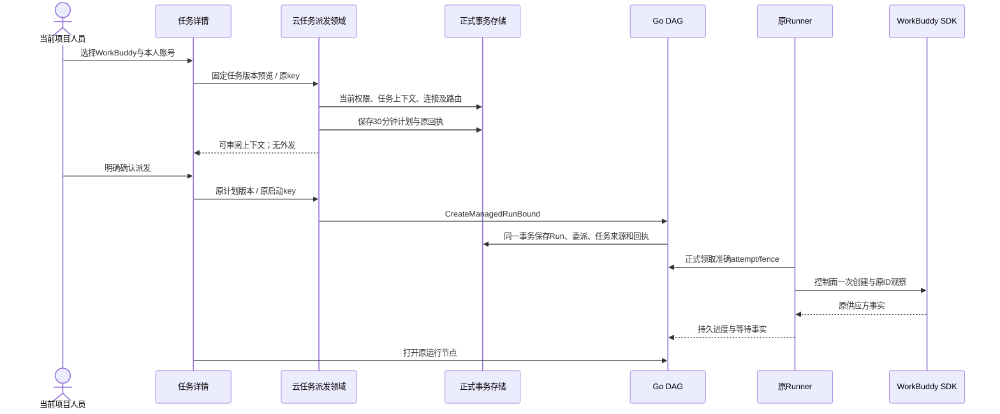

# 任务到云智能体：架构与 AI 开发 SOP

状态：T-WORKBUDDY-TASK-DISPATCH-168源码与隔离联调限定通过；负责人：主集成代理；suma 1.0.0；2026-10-31。关联需求：多工具统一指派、任务开发、团队／分布式调度、可视化配置与多语言。完整范围见[统一实施计划](../delivery/implementation-plan.md)，接口与语义见[合同](../../contracts/workbuddy-task-dispatch.md)，环境及未验边界见[验证报告](../quality/workbuddy-task-dispatch-verification.md)。

## 领域分层

任务内容、外部工作流执行和交付证据分开建模。`TaskContext`提供服务端已授权任务与需求、设计、知识、已发布测试计划；`WorkBuddyTaskDispatchPlan`保存本人确认的准确快照和预留运行身份；现有`CloudDelegation`授予准确run/node一次创建；原Worker与中央WorkBuddy SDK负责外发与观察。平台只有Go DAG拥有派发权。

新计划不继承本机ToolProfile。云账号授权不是安装探测，云会话状态不是代码候选，供应方完成不是独立测试或验收。受保护代码基线尚不能传递核验时明确拒绝，不能将无基线运行冒充同一开发任务。

## 一致性和边界

预览读取当前账号元数据，不解密、不探测供应方、不预留机器槽位；任务上下文在服务端解析，32000字节上限不能通过截断规避。启动重新校验任务、需求、设计、知识发布、测试计划、连接版本／代次及客户端绑定、项目路由和两级预算。不能以GET中的valid字段替代当前权限。

工作流先将typed云绑定转为规范JSON map再保存，避免持久化前后对象键序改变摘要。新计划公开节点使用空数组；节点摘要另按Core从Edges重建依赖后的准确形状计算。显示输入与执行规范形状的区别明示，不通过省略字段或容忍错误摘要恢复。原Run的全局Node空数组／null类型差异仍需统一合同收口。

原Run创建回调中，初始version0和attempt0是同事务内部事实。领域只允许这一明确接缝签发新委派；公开委派接口的版本规则保持严格。路由、任务绑定／依赖验收、provenance、计划CAS和receipt任何一步失败全部回滚。事务结束后Runner才可能领取，不留未授权窗口。

启动响应丢失时，用户核对原操作；原key／同正文取回同一Run。重放仍验证当前人员项目权限，不能因原账号已消费委派而重新授权或新建运行。明确新操作需要重新预览；未知响应不能默认重试供应方创建。

已发布测试计划保留为任务范围快照。云单节点没有独立测试执行或通过记录；后续可信云制品导入接入原候选管线后，才可取得同提交测试证据。正式验收继续要求真实Run成功及独立测试，现有waiting不能通过。

## AI 开发 SOP

1. 先读取当前合同、`memory/current_state.json`及原云Runner合同，只修改获分配模块；共享生成合同与接线由主集成负责。
2. 以服务端快照构造目标，外部任务内容只作数据；不接受prompt、目标URL、任意模型或供应方task ID覆盖。
3. 写入沿原事务、CAS和稳定操作标识；设计未知回执及撤权恢复，再实现正常路径。
4. 前端只展示正式事实：当前账号、固定任务范围、供应方管理模型、费用未知、正在等待的具体原因；必要高级细节默认收起。
5. 对权限、回放、原子回滚及受保护上下文做定向检查。原Worker／HTTP／SQLite与中英代表界面验证分开记录，不反复跑无关全套或调用收费模型。
6. 更新同一阶段证据与待交付能力；源代码、受控供应方运行、真实供应方、多机及生产分别记录。核对原有工作未变后，阶段commit并正常推送dev。

## 参考及扩展

Multica本地参考提交`e8ae72c9dfc1b4474b61a9087f51b33cbee6a048`用于任务分配与运行工作区模式研究。本阶段直接复用Suma现有Go DAG、成熟WorkBuddy SDK、授权／事务、任务上下文和Web组件，不复制该提交附加许可限制代码。通用ACP／Qoder、持续输入与权限、云制品／基线、独立测试和完整团队角色继续按原领域逐步贯通；不添加另一调度内核。
