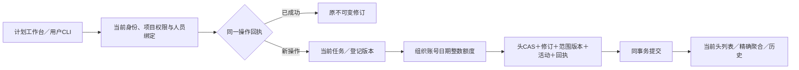

# 人员工时领域与一致性

状态：T-WORKLOG-135；负责人：计划领域。关联P3人员协作、[线合同](../../contracts/worklogs.md)、[操作SOP](../development/worklogs.md)与[限定验证](../quality/worklogs-verification.md)。

人员登记作为计划领域的独立模块，复用控制面当前权威、原页面身份、操作回执、SQL方言、活动和错误目录。浏览器与Go CLI复用一套HTTP合同；不会让Runner／智能体代理人的主观登记。日历、估算、人员登记与机器用量分别保存，各自表达来源和未知。

`suma_worklogs`只保留可索引的当前头事实，正文与身份快照位于不可变修订；读取通过头版本连接其修订，避免两个正文来源分歧。每次修订保存原人员、任务版本／标题、修改者与代办声明、日期和分钟、原创建与当前修改时间。人员ID不可更正；修改任务时重新检查当前任务版本。作废增加修订，未删除任何原件。

全组织日期台账按真实账号而非项目资源计量，避免同一人在不同项目拥有不同资源ID绕开上限。跨日期更正的增减合并、排序、同事务预留；台账条件更新防止负数或超过1440。登记头版本CAS冲突使此前台账变化回滚。额度失败不返回其他项目的明细。

项目范围版本与每次变更同事务递增，游标绑定版本和筛选。列表是明确≤31日、≤50项的当前头投影；精确聚合覆盖筛选范围而非当前页。历史分页只读，历史可操作提示关闭。权限在每页和每次回执恢复前重新核验；历史快照不是新的授权来源。

初始schema对四表列与复合主键先检查、后写入。新域不从计划／日志补造历史，不提供兼容分支。SQLite为本轮实际事务证据；OceanBase／PostgreSQL使用现有方言和元数据查询，但真实服务验证须独立留证，不由SQLite结果替代。

扩展可接入“受审阅的工时审批”和组织报表，但必须引用登记修订及来源，不回写其历史。若引入自动计时，应另建测量来源、明确人员确认与隐私策略，不能把当前`human_manual`含义改变为机器证据。
