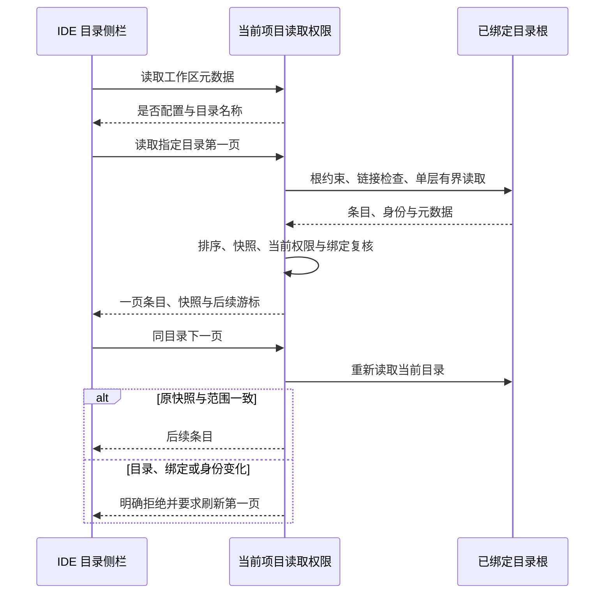

# 本地 IDE 目录浏览与分层文件导航

状态：T-WORKSPACE-106／1.0.0，本机限定验证通过；负责人：控制面、工作台、主集成代理。关联 P2、需求9／10／15／22。[线协议](../../contracts/workspace-tree.md)、[完整交付范围](../delivery/implementation-plan.md)。

## 领域边界

工作区绑定、目录观察、编辑草稿、文件保存、Git 差异和正式代码候选分别管理。工作区元数据只说明当前绑定；目录结果是当前项目权限下的一次有界观察，不产生开发执行权，也不替代封存候选或测试证据。

## 模块与资源

`workspace.go`负责原有绑定／保存与轻量元数据，`workspace_tree_http.go`封闭请求参数，`workspace_tree.go`负责当前目录观察，导出 DTO 由现有合同生成器生成 OpenAPI／TypeScript。操作复用当前浏览器或项目 API 身份与 `workspaceReadGuard`，不新增表、队列、迁移、进程或依赖。

目录使用已验证根约束，拒绝所有路径组件的链接和敏感路径；既有秘密文件排除策略继续适用。只打开当前目录，限制原始条目扫描数与单页条目数，不递归查找。快照包含可见条目身份及必要元数据；访问时间不作为变化依据。快照不表示整个仓库或文件内容已经固定。

## 交互与异常

`WorkspaceTree`独立拥有目录请求、过滤与分页状态，`IDE`继续拥有当前文件、草稿和原保存命令；目录切换不会卸载 Monaco。面包屑、返回上级、目录按钮及加载更多均可键盘操作，文件列表标明当前项。筛选只作用于当前目录已经加载的条目，范围提示明确区分“还有更多”与“目录已加载完”。

项目或 API 身份变化时取消旧请求并隐藏旧目录；进入新目录先清除前一目录列表；重新打开文件视图也重新读取当前目录，不把隐藏前的授权观察当成新状态。分页响应必须与原目录、项目和快照相符，重复、迟到或混合数据不能拼接。目录变化后保留用户编辑草稿，但目录列表要求明确刷新；权限失效不通过缓存继续显示原目录。

平台状态、错误、数字和操作支持中文／英文；文件名、路径和代码保持原始内容。继续复用 React、现有设计令牌、Lucide 和 Monaco，不另建 IDE 框架。12ui CLI 在当前环境不可用，本阶段没有安装新工具、调用付费图像服务或改变设计系统。

## AI 开发 SOP

共享 DTO 先确定，再并行实现后端观察和工作台；主集成代理统一生成合同与执行 Go 检查。先运行分页、范围、当前授权、目录变化和草稿保护等受影响用例，再做一个真实本机界面旅程。原始输出及截图保留在忽略目录，Git 只保存源码、设计与精简验收记录。目录分页不代表完整 IDE、物理多机或规模验收完成。
