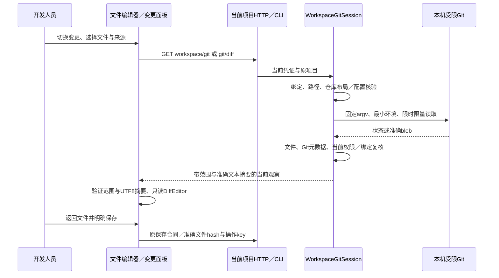

# 实时工作区Git读取与编辑模型边界

状态：T-P4-035设计及实现，限定本地验证通过。负责人：控制面／工作台。关联合同：[Workspace Git](../../contracts/workspace-git.md)。

控制面使用现有`workspaceRoot`及`workspaceReadGuard`；业务授权前后复核。文件读取通过Go `os.Root`限定目录，已存在路径组件不能是链接；普通并发替换／修改通过文件身份、大小、mtime与读取长度复核拒绝。当前观察不声明恶意宿主可变文件系统中的原子快照，正式交付继续使用已封候选。

Git通过固定仓库路径及命令参数读取，状态使用NUL分隔解析，不按空格猜文件名；原文使用`ls-files`／`ls-tree`取得准确对象ID，再以`cat-file blob`读取，避免外部diff、textconv或工作区过滤器改写内容。原生Git输出上限、请求截止时间、最小环境、危险配置及链接／替代对象库检查详见合同。暂存删除与同路径未跟踪记录在安全过滤前聚合，既不重复路径，也不丢失来源事实。

工作台只有一个文件编辑模型及原保存控制器；Git面板独立持有读取世代和取消信号。DiffEditor使用独立`suma-git`模型URI，不能复用正在编辑的文件模型；只读比较验证两侧准确UTF-8摘要。按项目与原API调用者标记状态，身份变化在渲染时即隐藏旧观察，不能只等effect清理。切换文件／变更保留原模型；Git刷新不触发写入或执行。

未提交仓库与分离HEAD有明确状态。现有文件绑定仅授权该root，不自动授权位于其他项目的共同Git目录；链接工作树必须补充项目仓库绑定后接入，禁止借全局目录允许范围越权。控制面本地文件布局与分布式Runner工作树是不同执行位置，后续通过同一授权仓库合同暴露节点侧能力，不能把本机读取声称为远端已贯通。

原生执行限额由已有Runner在准确工具及用途校验后解析，重建stdin时显式传递到SDK；修复的128步／单次1024流证明使用准确修复协议分支。SDK累计输出额度及现有用量预留保持各自语义；独立可写模型身份、参数、费率与实际请求证明见[后续设计](035-model-selection-design.md)。
