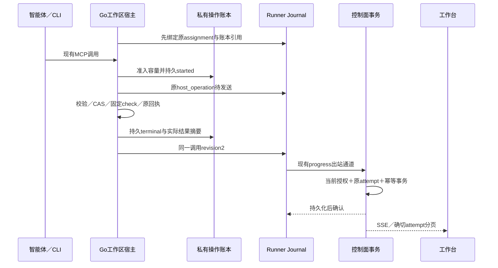

# 工作区操作可追溯架构

状态：当前1.0.0实现；负责人：执行运行时／控制面／工作台。需求：13、23；阶段：T-WORKSPACE-120。规范：[合同](../../contracts/workspace-operations.md)；检查范围：[报告](../quality/workspace-operations-verification.md)。

宿主调用、文件效果、SDK活动与DAG状态分属不同记录。Go仍是唯一工作区写入与任务派发权威；本模块为现有调用补齐安全元数据，不从SDK事件推断工作区效果。

本地`sequence`保持宿主实际顺序；外层持久事件允许重传与乱序接收。平台以原身份、调用头、修订与序号槽防止重复或冲突。独立的SDK报文不能携带宿主信封。Host记录到达只写事实，不改变node完成、租约、配额或人工审批。

文件效果账本保存原CAS与可恢复结果，宿主调用账本保存开始／结束元数据。重复效果ID返回原结果，但新的宿主调用仍有独立身份。所有公开投影经过闭合合同校验，绝不将私有账本整体上传。

父Journal在MCP开放前保存账本引用。崩溃恢复通过受限目录读取、大小／JSON界限和assignment／策略／工具摘要核对，仅导入事实。缺少终态表示未知，后续需要原效果核对；恢复不会假设“未执行”或自动重跑。授权撤销可阻止补传，界面不能把本地完整采集说成远端确认完整。

前端复用当前事件与历史分页。操作区默认收起；展开后支持失败／未知筛选和简短详情。原检查输出只有与效果、世代、策略和结果完全匹配时可打开。缺失详情、缺失覆盖、窗口外记录都明确表达，不补零、不补假时间、不按SDK活动数生成百分比。

本模块是现有执行域的深模块：共享闭合合同负责数据不变量，Runner负责真实采集和本地恢复，DAG负责持久事实及回执，HTTP负责当前权限，UI只做读取与导航。产品版本维持1.0.0；业务库`suma-initial-quality-v1`不因新增可选元数据而迁移或重置。
