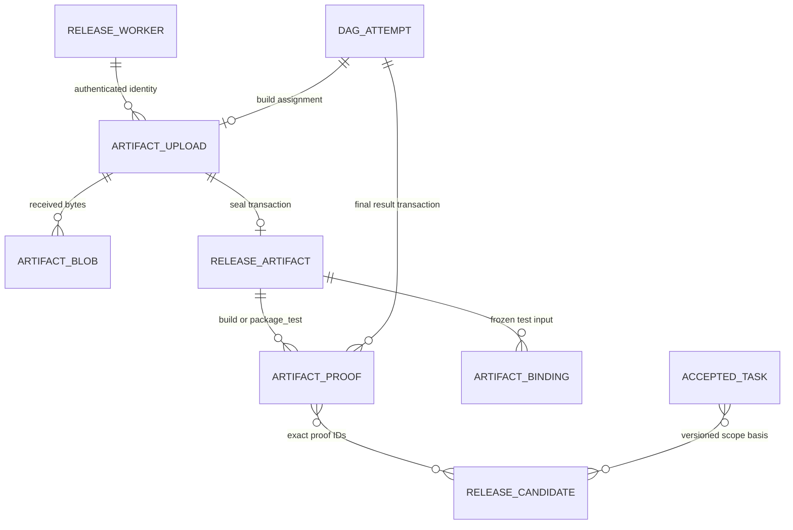
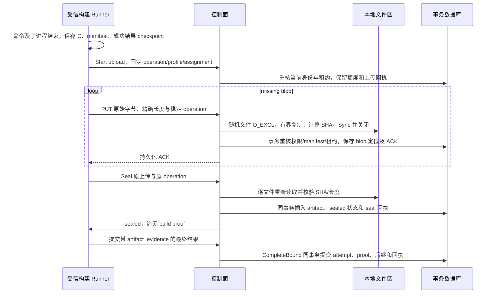

# 发布制品存储、封存与消费一致性

| 文档属性 | 内容 |
|---|---|
| 状态 | 2026-10-24，依据当前源码整理的本机实现说明；完整平台验收继续进行 |
| 负责模块 | 主集成代理：制品控制面；执行代理：Runner 与本机提供方 |
| 关联需求 | [实施计划](../delivery/implementation-plan.md) 的 P5 制品、测试、发布与问题回流 |
| 共享合同 | [发布执行合同](../../contracts/release-execution.md)、[发布控制面合同](../../contracts/release-control.md) |
| 配套设计 | [发布证据与授权架构](../architecture/release-evidence.md)、[本机提供方](../integrations/release-provider.md) |

## 1. 存储边界与正式事实

首实现保存 `static_site_v1` 制品。元数据、执行归属、证明、候选、操作回执放在控制面的事务数据库；实际文件放在 `Service.DataDir/release-artifacts`。当前实测数据库是 SQLite。数据库中的 tenant/project 过滤与当前凭证校验决定读取权限，文件摘要本身不授予权限。

本实现直接由平台 Service 管理本地文件和 SQL 表。完整平台计划中的 `ArtifactStore` 抽象、S3 兼容适配、跨节点共享命名空间、分布式存储迁移与恢复仍需实现和分别验收；不能把本机文件上传解释为这些能力已完成。OceanBase/PostgreSQL 的驱动、DDL 方言及数据库时钟分支已存在，但本轮发布链路没有真实集群验收。

必须分别解释以下字段：

| 正式事实 | 形成条件 | 能说明的范围 |
|---|---|---|
| 上传 `receiving` | 当前受信构建 assignment 创建固定 manifest 的上传会话 | 上传意图和保留额度已保存 |
| 制品 `sealed` | 服务端校验全部文件后，事务提交制品、上传状态和回执 | 实际文件存在且与清单一致 |
| `build` proof | 当前成功构建 attempt、固定源码 C、管理员 profile 与封存字节在最终结果事务中匹配 | 受信 Runner 对这份包的构建事实 |
| `package_test` proof | 固定包输入、固定源码 C 和实际测试命令的成功结果匹配 | 对同一份封存包执行了登记测试 |
| ReleaseCandidate | 同一 run 的两类 proof，加上当前有效的正式任务验收依据 | 一份不可变交付范围快照 |
| 部署与健康 | 独立授权和提供方持久观测 | 指定环境、operation、generation 的实际效果 |

制品列表与详情读取持久元数据和历史 proof，不会因刷新自动重新认证所有历史字节。seal、输入解析、候选有效性门禁、真实 blob 下载等路径才执行相应字节复核。界面显示 `sealed` 不能替代当前完整性检查或测试结论。

## 2. 数据表、唯一性与文件定位

迁移入口是 [artifact_schema.go](../../internal/platform/artifact_schema.go)。下表为实际表名；关联关系主要由服务事务校验，不代表 DDL 已逐项声明外键。

| 表 | 保存内容 | 关键约束 |
|---|---|---|
| `suma_release_workers` | 专属 worker、凭证 hash、profile 登记、部署权限、有效期与状态 | tenant/project/worker 唯一；撤销保留身份墓碑 |
| `suma_artifact_uploads` | manifest、摘要、长度、固定 assignment/profile、状态及 artifact ID | tenant/project/run/node/attempt/fence 唯一 |
| `suma_artifact_blobs` | 上传会话内的 digest、长度与内部 storage_path | upload/digest 主键 |
| `suma_release_artifacts` | 封存 manifest、摘要、长度和来源 upload | 每个 upload 至多一个正式制品 |
| `suma_artifact_bindings` | 某测试 attempt 首次解析得到的固定输入与构建身份 | run/node/attempt 主键；校验时同时匹配 fence/worker/范围 |
| `suma_artifact_proofs` | build/package_test、完整 assignment、制品、源码和 profile/workspace 摘要 | run/node/attempt/kind 唯一 |
| `suma_release_candidates` | 不可变候选 JSON、名称、创建时间 | 只创建与读取；无原地编辑入口 |

`blobs/<服务器生成的随机 ID>` 是当前磁盘定位，原始路径不会返回给客户端。文件 SHA 是内容标识和验证依据；当前仅在同一 upload 内按 SHA 去重，未实现全局跨上传去重。两个路径指向相同 digest 时必须声明相同长度；制品逻辑总大小仍按所有 manifest 条目计算。不得据此宣称已经存在全局内容寻址对象存储。

## 3. Manifest 规范与实际限额

唯一规范入口是 [CanonicalManifest / ValidPath](../../internal/releasecontract/artifact.go)：复制 files，按路径排序，对固定类型声明顺序的 Go compact JSON 计算 SHA-256。业务 JSON 的对象键排序不能自行代替该编码。manifest 摘要绑定 schema、kind、全部相对路径、长度及文件摘要。

| 项目 | 当前实现 |
|---|---|
| schema/kind | `schema_version=1`、`kind=static_site_v1` |
| 文件数 | 1–128；允许零字节普通文件，不允许空制品 |
| 单文件/制品 | 最多 16 MiB / 64 MiB |
| Runner 遍历 | 最多 4,096 个目录条目，超限失败 |
| 项目保留额度 | 上传会话声明大小累计最多 1 GiB；当前为源码固定策略，尚无额度管理 UI 或自动回收 |
| 路径 | 总长最多 240 字节，单段最多 128 字节；便携 ASCII 子集和 `/` 分隔 |
| HTTP | JSON 请求采用控制面的 2 MiB 上限；blob PUT 单独采用 16 MiB + 1 的有界读取检查，要求精确 Content-Length |
| 上传方式 | 单 blob 重传；无 Range 分片、压缩包解压或客户端指定磁盘目录 |

路径拒绝绝对路径、`.`/`..`、空段、反斜线、百分号编码歧义、Windows ADS/设备名、尾点、大小写折叠冲突、文件与目录前缀冲突及保留段 `.suma-release`。Runner 采集与提供方物化还核验普通文件、单硬链接、父目录身份、打开前后文件身份与内容；符号链接、junction/reparse 路径和不稳定文件不能当作制品。控制面使用 `os.Root` 限制服务器生成定位，并在读取时校验打开身份、长度和真实摘要；这些检查不等于完整操作系统沙箱。

## 4. 上传与原子封存

实现入口为 [artifact_storage.go](../../internal/platform/artifact_storage.go) 与 [artifact_http.go](../../internal/platform/artifact_http.go)。协议使用完整 assignment：run/node/attempt/fence/worker；tenant/project 来自认证范围，不能由请求自报替代。

1. Start 先规范化 manifest，再校验管理员登记的 worker/profile 及当前数据库租约；一次 attempt 只能有一个上传会话。项目额度的预留也在该事务内完成。
2. PUT 在数据库锁外接收有界字节，使用服务端随机名、独占创建和真实 hash。只有内容正确，且事务中再次核验权限、上传归属、manifest 与当前租约后，才登记 blob 与 ACK。
3. 正常失败或同内容重复会删除本次新建的未登记临时文件；不会删除旧 blob。已有 blob 在返回可重放 ACK 前重新读验。复用 operation 改 digest/长度返回冲突。
4. Seal 重读全部真实文件，然后原子提交 `suma_release_artifacts`、upload sealed 状态和原操作回执。重新用原 key 请求返回原 artifact；更换 key 不能封存出第二个制品。

这里的原子性是**数据库可见封存事实**的原子提交。文件先写入并 Sync，SQL 不能回滚物理文件写入；突然进程退出可能留下未被数据库引用的文件。当前未实现自动孤儿扫描/GC，也没有断电文件系统一致性验收。不能把此协议描述成文件系统与数据库之间的分布式事务。

## 5. 事务证明、固定输入与消费复核

### 5.1 构建与包测试证明

[verifyArtifactResultTx](../../internal/platform/artifact_proofs.go) 由 HTTP 最终结果入口的 `CompleteBound` commit 回调调用。它在本次 attempt 已写入、后继尚未激活时核验并插入 proof；proof 失败使 attempt、资源状态、后继、事件和操作回执整体回滚。没有独立的客户端“提交通过证明”接口。

成功 proof 同时要求：当前受信 worker、登记 profile ID/种类/SHA、成功且非 stopped/unknown 的最终结果、干净 workspace evidence、完整 C，以及 `base_commit=head_commit=source_commit=C`。build 还要求本次上传/封存的身份与凭证完全匹配；package_test 要求明确 test 节点、`test_command=true`、服务端固定输入和当前有效 build proof。失败或未知可以保存观测，不能形成成功 proof。

管理员 profile 摘要覆盖**配置**：可执行文件路径、参数、固定 Env 值、EnvFrom 名称、输入、隔离/测试标志和制品配置。它没有读取可执行文件或脚本的实际字节，也没有自动固定工具二进制版本；EnvFrom 只绑定变量名，不绑定运行时秘密值。对外只发送最终摘要，不发送 Env 配置值。因此该事实依赖管理员维护的可信主机和命令配置，不能称为可复现构建、独立供应链签名或 executable bytes attestation。

### 5.2 固定包输入

`ResolveArtifactInput` 只允许当前 test 节点的 `config.artifact_from` 指向同一静态流程的 command/agent 构建祖先，且测试命令 alias 已登记为 package_test。服务端查当前成功 build attempt/proof，重验封存字节，并把 artifact、manifest、C 和 build assignment 与当前测试 attempt 同事务绑定。客户端不能传任意 artifact ID 代替来源。

Runner 根据绑定确认本机已有 C object，且满足管理员基线祖先约束，再建立独立工作树；缺 C 失败，不自动 fetch 或回退 B。实际 blob 下载逐个校验长度/SHA，物化后重算 manifest；登记测试通过进程局部 `SUMA_ARTIFACT_DIR` 读取这些字节，测试后再次重算完整输入。测试中改包、只测试另一个包或工作树改动，不能形成 package_test proof。

提供方另从授权 operation 读取同一封存制品，重算 manifest 和文件摘要；物化版本核验无额外文件后才激活。静态 HTTP 每次读取也校验当前 manifest 中的文件。包测试与目标健康分别保存，任一方不能替代另一方。

## 6. 恢复、权限与锁顺序

Runner 在上传前持久化 artifact transfer 和成功进程结果，operation 由固定 assignment/worker/phase 确定。重开 journal 后复用上传、blob 和 seal 操作，不为 ACK 丢失重新构建。当前凭证仍须有效；已保存同内容回执可以恢复，但不能借重放为旧 attempt 新增字节、改变制品或重新制造 proof。详细恢复验证见 [提供方接入说明的执行证据](../integrations/release-provider.md)。

涉及业务授权与执行状态的事务遵循 **organization → DAG scheduler → environment**。`authorizeProjectTx`/`releaseWorkerTx` 先取得当前组织权限；`currentArtifactAssignmentTx` 再锁 `dag_lock`，使用数据库时间判断租约。`CompleteBound` 的 before 回调在 scheduler 锁之前执行，commit 回调仅使用传入事务。不得在回调内另开 Engine 写事务或调用网络。

制品读取仍按 tenant/project 和对象成员关系授权。Runner 下载还要求当前测试 assignment 与冻结输入；Provider 下载要求已消费的固定部署 operation；浏览器下载使用附件响应而不是在控制面源站内执行上传 HTML。worker 凭证仅首次返回，服务端保存 hash；撤销删除会话与 scope、保留 worker 墓碑和历史证据。

## 7. 候选有效性与保留策略

[CreateReleaseCandidate / validateReleaseCandidateTx](../../internal/platform/release_candidate_service.go) 绑定同一 artifact/manifest/C、同一 run 的 build 与 package_test proof，以及 1–100 个实际由该 run 交付且正式验收的任务。任务依据保存 task version、run、review ID、需求版本和依赖依据摘要，排序后形成 scope SHA。候选不可编辑。

当前 eligibility 查询重核当前成功 attempt、不可变最终结果、实际文件和正式验收依据。需求、任务、运行尝试或验收改变后，历史候选仍可追溯，但当前 eligibility 变为 false；不自动给旧 proof 或批准换版本。列表使用真实 keyset 页，默认 20、最大 100，当前排序为 `created_at DESC,id ASC`，total 为当前项目总数；不能把当前加载页当作全项目统计。

首轮保留上传、制品、proof、候选和部署历史，不自动清理。未来 GC 必须从候选、计划、历史部署、未决操作、测试绑定及恢复 journal 建立引用边界，保留禁止 operation 重用的墓碑。该 GC 与可调额度尚未交付。备份恢复必须联合验证数据库引用、实际 blob、Provider active/revision 和必要 Runner journal；只有数据库快照不足以恢复发布能力。本页不提供未经验证的一键恢复命令。

## 8. 证据与后续验收

| 检查范围 | 源码与证据入口 |
|---|---|
| 真实字节→proof→正式验收候选 | [artifact_integration_test.go](../../internal/platform/artifact_integration_test.go) |
| 错字节、缺文件、跨范围、失效租约、一次凭证 | [artifact_security_test.go](../../internal/platform/artifact_security_test.go) |
| 实际采集/包测试、seal ACK 丢失、journal checkpoint | [Runner 测试](../../internal/runner/artifact_test.go)、[原始执行记录](../quality/evidence/release-execution-tests.jsonl) |
| proof 回调失败时整体回滚 | [managed_test.go](../../internal/dag/managed_test.go) |
| 候选门禁、独立发布授权、真实 HTTP 与回退 | [发布控制面验证](../quality/release-control-verification.md)、[范围与源码摘要](../quality/evidence/release-control-review.json) |

上述证据分别注明覆盖范围，不能累计解释为 S3、OceanBase/PostgreSQL、生产目标、签名、断电恢复或规模指标已通过。后续需要单独完成对象存储适配、备份恢复演练、GC/额度治理、执行工具字节固定与生产容量验证，再扩大正式支持范围。
