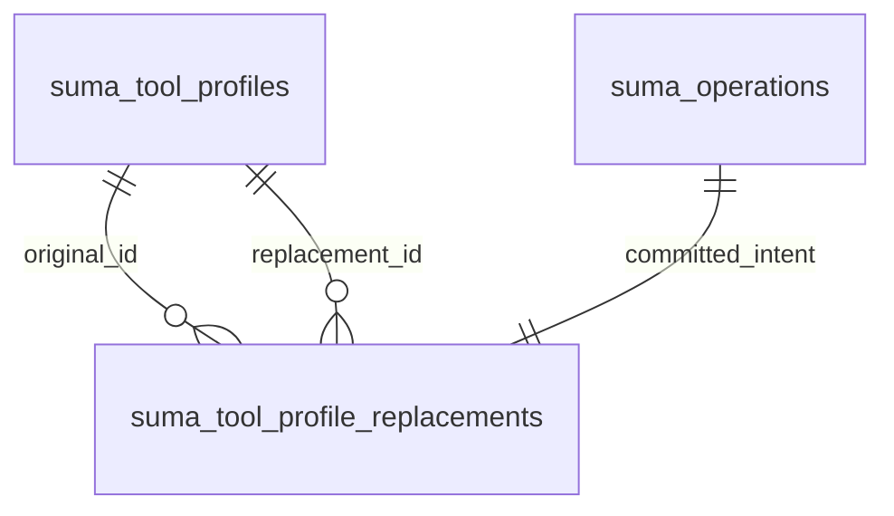

# 配置交接数据与一致性

T-TOOL-REPLACEMENT-200；suma1.0.0；关联[合同](../../contracts/tool-profile-replacement.md)、[架构](../architecture/tool-profile-replacement.md)。

图中是领域事务关系，未伪称新增数据库外键。`suma_operations`仍是原actor／body／operationID的回执权威；关系表负责按配置查询不可变交接，不代替profile当前状态。

| 字段 | 用途 |
| --- | --- |
| tenant_id、project_id、id | 复合主键与租户／项目边界 |
| original_id、replacement_id | 原项与目标项；两条方向索引 |
| created_at | 固定九位UTC，与ID组成keyset排序 |
| payload | 完整公开关系快照、原提交actor、disposition与暂停选择，最多2MiB |

两条方向索引按tenant/project/profile/created_at/id组织。SQLite／PostgreSQL使用TEXT；OceanBase沿现`Service.ddl`将TEXT映射LONGTEXT，避免另一套方言。这里只说明实现映射，真实数据库矩阵仍独立验收。

原配置CAS、候选创建或明确复用、可选原项暂停、关系记录和原回执处于同一授权事务。提交前只编码一次完整结果，用与读取相同的上限和解码规则验证，再复用同一raw写两处；容量、类型、约束或插入失败均回滚。不得让首写成功却在后续恢复／读取时必定失败。

读历史不重新观测、不改快照；当前启用和派发独立读取正式profile。列表最多100项及8MiB items预算，逐项线性计量，到边界不跳过候选；游标精确绑定租户／项目／actor／profile／方向／limit，不能伪造全量total或一致快照。

新关系表缺失属于首次初始化的正常创建；已有未知布局在所有DDL前拒绝，不清库或补历史记录。备份与恢复需要同时保留业务配置、关系、原操作和授权数据；单独复制一张表不代表原操作已完整恢复。

验收范围与剩余限制见[限定验证](../quality/tool-profile-replacement-verification.md)。
