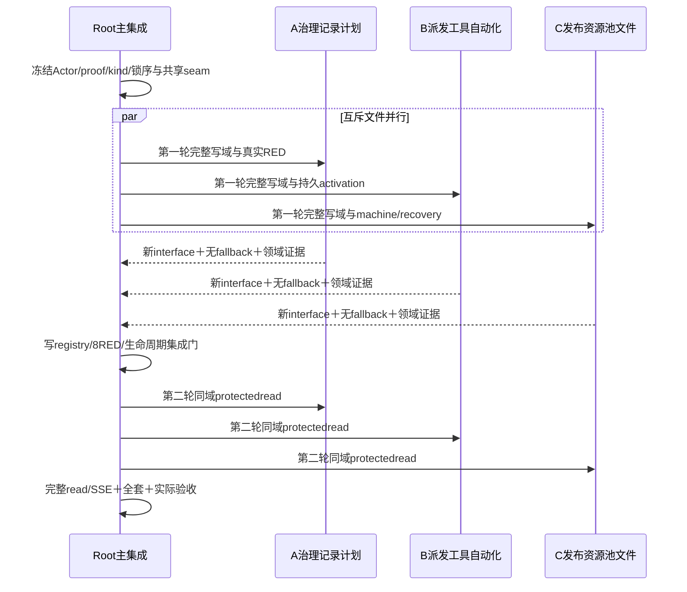

# 当前凭证权威性实施计划（v1冻结基线）

> **For agentic workers:** REQUIRED SUB-SKILL: Use subagent-driven-development or executing-plans to implement this plan task-by-task after Root freezes it. 现按冻结合同实施；Root先完成可编译共享seam，再下发三域并行任务。

**Goal:** 关闭全部已实现应用写入／成功回执和受保护读取对过期、撤销、错误kind/scope及过时来源身份的接受路径，同时保留真实机器／持久activation独立语义。

**Architecture:** 以封闭Actor表达实际来源，由当前权限深模块在同一sql.Tx获取组织→账户协调→credential/session→project/scheduler顺序的当前权限，返回绑定target/purpose/tx的proof。领域写入、回执与DAGcallback消费proof；Principal只是投影。分两轮完整切面，全部写闭合之后继续全部protected read/SSE，不能只交付teams/tasks修复。

**Tech Stack:** 现有Go、database/sql、internal/store和已配置sqlite/postgres/oceanbase驱动；现有HTTP/CLI/Runner/agent-runtime与Web。不新增依赖、不升级工具链；OIDC库选择另有设计。

**Spec:** [current-credential-authority合同](../../contracts/current-credential-authority.md)、[架构](../architecture/current-credential-authority.md)。状态v1冻结／实施中；013已本地提交，当前验收证据仍是013，P0–P7总范围保持。

**修订：** proposal-1-r1，回应独立评审CCA-PROP-01..04。Root已选择legacy一次性重新认证／发行，不采用scope自动回填Grant的兼容路径；四项设计发现已独立闭环，Root接受行为及责任基线；共享 Actor、领域命令与读取 seam 已进入并行实现；完整集成、实际产品验证与交付仍待完成。

## 2026-10-25 实施检查点

以下原始任务条目是冻结时的验收目标，不以提议测试名称是否出现判定完成。当前实际进度以本表、源码与[阶段验证](../quality/current-authority-verification.md)为准；未实际完成的运行／后端矩阵不勾为通过。

| 切面 | 当前进度 |
|---|---|
| R1 真实来源、生命周期与共享事务能力 | 已实现；实际 Actor、来源／家族／Grant／slot、排序锁、DB-time 与首次预算有本地定向证据 |
| R1 A／B／C 命令与持久委派 | 已实现并分域验证，移除旧 Principal 写入／授权／回执旁路 |
| R2 全部已实现的受保护读取、原文、文件、SSE | 已迁移；SQL 同事务、IO 前后重检与精确机器来源，本地 SQL／HTTP 证据与集成收尾已完成 |
| 原页面上下文、CLI 和 OpenAPI | Web 捕获原调用者，CLI 显式身份参数，219 域模型／220 Schema 与 153 路径已生成 |
| 集成检查 | 前端 796／57 文件、目录 2851 与生产构建通过；Go 全量已执行，8 项旧夹具／旧读语义按实际新合同定向修复并通过；AST 2 项／25 样本通过；24 程序／6 目标同源编译完成 |
| 升级／运行及数据库矩阵 | 旧预览已恢复精确 013 静态版本；014 尚未切换用户库或服务。PostgreSQL／OceanBase、跨平台安装与规模目标待实际验证 |

## Global Constraints

- 交互commands不能以裸Principal授权；所有既有写入口迁移到Actor，无缺凭证fallback、旧无guard wrapper或JSON可选system/delegation。
- kind来自服务端发行记录，label仅显示，Cookie/Bearer不决定kind；保留user-api现有合法project功能，个人偏好／未来SSO link必须真实browser。
- organization→账户协调→credential/session→project/scheduler锁序；logout/revoke/rotate/成员变更/issue同协议；多组织完整集合排序、锁后复核，最多3次回滚重试。
- DB-time保守秒精度；shorttx拟5秒，接受点有效、禁止事务内长外部I/O；prepare接受后的可信恢复独立，不借旧browserproof。
- browser switch同session-family/generation固定authenticated_at/absoluteexpiry，不能延寿；独立token由kind/tenantpolicy＋显式Grant的TTL/scope/quota上限决定，不cap浏览器剩余TTL；Root已选全部缺可信source/family或Grant证明的legacy（含旧scopedtoken）reissue-required，原row/scope/expiry留审计，auth/currentproof401，不补造Grant。
- Logout按kind：browser撤销完整本family/generation，API/Runner/Agent只撤销owncredential/slot；独立loginfamily、其他Grant/durableactivation和identitysource不受普通logout影响。重复/已撤销200不二次递增generation/version，不产生新成功receipt/activity，见CCA-008B。
- 所有成功receipt前guard；Review双tx、workspaceprepare/finalize、reconcile多tx和Enginepublish/create/commandcallback均单独覆盖。
- Runner/Agent/pool/provider真实scope；durableactivation独立browserlogout而依当前角色／activationrevision；System仅可信持久event/run/outbox派生。
- 本阶段第二轮含全部已实现protectedread/SSE，公开bootstrap/静态/签名/独立机器协议另列；未来MCP/A2A/OIDC不冒称已有实现。
- 仅任务.cache临时数据，正式.suma和013冻结资料保持；不在盘根目录建任务目录。构建/测试环境变量仅当前进程。
- 源哈希绑定实际Go/adapter输入，前端与docs的合法并行修改不算Go漂移；不同命令/版本切面不合并计数。

## Review Focus

- 同账号两session两org与并发新增membership/issue使bulk-revoke组织集合变化：必须rollback/retry且无死锁、漏撤销或在持session锁后补org锁。由R1-R0生命周期测试承担。
- 有效API token具有当前合法项目管理能力而label恰好browser，或browser secret经Bearer发送：kind必须不随label/传输变化。由R1-R0和三域各自正向测试承担。
- 早期reviewreceipt/prepare/externalread已通过后才logout：不得复用早期proof；已接受prepared副作用与全新拒写必须分别观察。由A/C测试承担。
- browserlogout后持久activation继续，但激活人降权／暂停／revision变更后新派发阻断；FailureIssue不能任意传tenant/project构造system。由B/A承担。
- 原文分页／SSE缓冲／大文件流已开始交付与撤销后新batch区分；locale切换不改rawtext、cursor、attempt。由R2-R0与三域reader测试承担。

## 0. 启动与提议冻结（Root，实施前）

- [ ] 读取AGENTS、memory/current_state、delivery/status及本组三文档；确认013冻结工作与Go源码阶段是否允许开始。未经Root确认本计划不实施。
- [ ] 将本地111行matrix纳入合同登记；核对不是111个人类写端点。对每行标记interactive write／protected read／machine／durable／private helper，并与全部HTTP adapter及directSQL比较。
- [ ] 按Root已选legacy重新认证／发行策略复核旧节点/活动attempt运维影响；再冻结Expected-Viewheaders/428、kind-specificfamily或ownslotLogout、独立Grant、secret slot、5秒tx预算、账户协调表/DB-time及workspaceaccepted recovery。不得重开scope自动补有效Grant的兼容fallback。
- [ ] 只对实际Go/adapter输入建立新hashmanifest：`internal/platform`生产Go、关键DAG/store、auth客户端adapter、go.mod/sum，必要领域tests单列。文档与前端不放Go稳定性门禁。保留013source/runtime旧证据，不重标为014。
- [ ] 记录现有八个RED，补拟议测试时不覆盖原probe/observed-gap；旧RED输入保持可追溯。此次草案没有执行这些步骤。

## 文件与并行所有权

一个主集成Root＋三个并行实现域。Root先冻结sharedtypes/interface，再允许领域worker并行。**下表是将来的实施边界，不是本次派生授权执行记录。** 同一文件任何时刻只有一个writer；Root共享文件完成首轮后移交时须明示，不边集成边覆盖worker文件。

| 所有者 | 专属生产源范围 | 专属测试／读迁移 | 明确不编辑 |
|---|---|---|---|
| Root R0 | types.go、auth.go、http.go、database.go/migration注册；新增command_actor/authority/lifecycle/clock/read/locks文件；transaction_authority.go、locale_preferences*.go、scheduling*.go；run_stream.go、attempt_tool_history.go、search.go、projector.go及跨域indexadapter；internal/dag所需authorityvariant；cmd/suma-control与生成contracts程序；必要统一web/CLI/client adapter | sharedauthority、lifecycle、compile/sourcegate、DAGcallback、读registry/SSE、schema、生成合同和全套集成 | 三域所有文件并行中不编辑；013资料保持 |
| A 治理／记录／计划 | governance.go、governance_teams.go、governance_invitations.go（AcceptInvitation/switch/browserSession发行部分先由Root移出新lifecycle文件）；records.go、delivery.go、evidence.go、planning*.go、baselines.go、planning_invalidation.go、failure_projection.go | 相应现有与新增领域tests；同域全部read；FailureIssue可信event来源 | types/auth/http/transaction_authority/DAG/shared新文件；B/C文件 |
| B 派发／工具／自动化 | task_dispatch*.go、execution_route_dispatch.go；tool_profiles.go/tool_inventory.go/tool_http.go；automation*.go（含ingress管理/接收/调度/history adapter） | 相应领域tests；持久activation／signedingress；同域全部read | Root共享、pool_runner_tools与C资源池文件；A/C |
| C 发布／资源池／文件 | artifact*.go；release_candidate_service.go、release_deploy*.go/release_failure_projection.go；execution_pool*.go、execution_pools.go、pool_runner*.go、pool_runner_tools.go、workspace.go | 相应领域tests；machine/文件恢复；同域全部read | Root共享、Bexecution_route_dispatch；A/B |

`governance.go`当前lockOrganization、`governance_invitations.go`的AcceptInvitation/switch/browserSession、`records.go` receipt/saveReceipt 是共享seam：Root在并行前**一次性**移至Root所有新lifecycle/authority文件并冻结新proof interface，A之后只改领域剩余内容；禁止两方同时改同文件。必要migrations由各域提交DDL需求给Root，不自行向database.go注册。未列明而由实际registry发现的跨域共享文件默认Root，Root先补所有权后再派工，不能两域各自推断拥有。

readadapter文件如planning_http.go归A、automation/tool/taskdispatch adapter归B、release/pool/workspace adapter归C；http.go集中dispatch始终Root。handler局部SQL如workspace binding迁入C应用方法，不能因为原位在adapter而漏guard。

## 第一轮：所有写命令／回执／生命周期闭合

公开API变化必须与应用interface一起验收，不能在最后才发现客户端不兼容：

| 变化 | 实施／生成责任 | 真实消费验收 |
|---|---|---|
| 原业务DTO保持、内部Principal→Actor | Root＋各域；Root生成contract | 既有用户旅程、versions/body/idempotency正文保持 |
| 全browserwrite原视图headers/缺失428 | Root统一client/HTTP与生成文件 | staleTab403，正常browser带头成功；API按自身scope不冒browser |
| auth/tokens稳定key、serverkind、Grant与secretreplacement | Root生命周期/DTO/generator | 真实scope/Grant原子写、同slot不扩寿、不回显历史secret |
| switch同family固定寿命与familylogout | Root生命周期/client | 正常轮换目标有效、原authenticated_at不变、普通logout与独立token分开 |
| legacy全部缺完整证明的session重新认证/发行 | Root迁移/运维/UI与节点凭证配置说明 | 旧scope无Grant401、原expiry/run/receipt保持、无假批准；新登录显式发行可用，活动attempt按租约核对而非fakeACK/duplicate |
| kind-specificLogout | Root生命周期/专用withdraw-onlyadapter | browser A/B family均失效，另一family和独立token保持；scoped仅ownslot失效；重复200无二次状态扩写 |
| currentauth失败401与完整protectedread/SSE | Root错误目录/readmodule＋各域read | 用户被要求重新登录，流停止新batch；历史cursor/rawtext保持 |

### R1-R0. 共享Actor、proof、锁协议与真实发行（Root，先冻结再并行）

**Create:** `internal/platform/command_actor.go`、`command_authority.go`、`authority_clock.go`、`authority_locks.go`、`credential_lifecycle.go`、`command_authority_contract_test.go`、`credential_lifecycle_test.go`。

**Modify:** 上述Root专属文件、store migrations注册、internal/dag/engine.go/commands.go/managed.go等实际authority入口；测试只在本任务新文件/既有对应域更新，不用overlay覆盖013证据。

**Consumes:** 当前真实session/token_scope/member/project表及驱动；原8RED；既有Runner/pool/locale测试。

**Produces:** 合同CCA-002精确Actor/target/purpose/proof；`AuthenticateActor`、`authorizeTx`、proof receipt/saveReceipt；kind/source发行和`IssueProjectCredential`、Actor版`SwitchOrganization`、私有withdraw-only `logoutTarget`版Logout；Engine`PublishWithAuthority`，现有before callbacks保证先于receipt。共享interface文本冻结，领域不可自行改名或兼容fallback。

- [ ] 写 `TestAuthorityActorRejectsZeroAndJSONConstruction`：零Actor、请求伪造internal/delegation/kind拒绝；允许有效credential；actor Marshal/Unmarshal不泄露或构造能力。
- [ ] 写 `TestAuthorityKindIgnoresLabelAndTransport`：user-api label=browser仍API，runnerlabel其他仍Runner，serverbrowser经Bearer仍browser；session kind/scope不一致拒绝；个人偏好拒API；合法API record/dispatch正向保留。
- [ ] 写 `TestAuthorityTransactionProofBindsTxScopePurpose`：错误tx/另project/另purpose不允许receipt或helpermutation；失效source不能恢复成功receipt。测试通过真实moduleinterface，不暴露proofconstructor给业务调用。
- [ ] 写 `TestAuthorityLogoutBothOrdersTwoConnections`：各自通过通道证明lock取得/commit顺序；logout先提交命令401无成功行；命令先取得guard则logout等待，命令先提交后logout成功；新请求401。无sleep。
- [ ] 写 `TestAuthorityAccountRevokeAndMembershipSetChange`：同账号2org/2session、并发newmembership/issue；锁后集合变化rollback，最多3次后retryableconflict；稳定后所有目标撤销，另账号不受影响；无死锁/漏session/新增成功receipt。
- [ ] 写 `TestAuthorityDBTimeAndDeadline`：固定DB边界（秒内/等于/刚过），测试不同应用时钟不影响判定；context取消/5秒预算超时无成功业务；不得通过sleep等expiry代替固定expiry。
- [ ] 写 `TestAuthorityIssueAtomicAndGrantLifetime`、`TestAuthoritySwitchPreservesSourceLifetime`：发行来源失效/错误kind/目标无权限拒绝；Grant/session/scopeinsert失败全回滚；独立Grantkind/tenantpolicyTTL而非浏览器剩余期限；switch固定familyauthenticated_at/absoluteexpiry；同operationsecret轮换但不延原Grant/familyexpiry；source/target排序锁。
- [ ] 同组加入browser只剩1分钟但按明确policy批准24h独立token的正向测试，browserlogout后API/Runner/Agent按自身currentGrant可工作；familylogout后switchbrowser失效，另一loginfamily保持；正常source/targetsecret轮换不销family、不使新session立即失效。account/compromise/authsourcegeneration撤销另验证，跨org集合变化确定断言，不能误伤durableactivation。
- [ ] 写 `TestAuthorityLogoutKindSpecificAndIdempotent`：真实browserfamilyA/B都401、另一loginfamily与独立API/Runner/Agent及activation仍有效；逐个scopedLogout只本credential和同slotreplacement失效，其他slot/Grant/source保持；重复/未知/过期目标200且无二次generation/version或successoperation/activity。withdraw-onlycontext不能交给authorizeTx授读写。
- [ ] 写 `TestAuthorityLegacyKindsMigration`：真实旧browser及runner/api/agent session+scope但无Grant全部保留row/scope/expiry并标legacy/reissue-required，auth/协议currentproof401；不造approved_by/source认证/family/issuance，不新增成功operation/activity，旧业务/执行/receipt摘要不变；真实重登＋新key显式发行后合法请求可用，重复迁移幂等且完整新模型行不降legacy。
- [ ] 同fixture保留旧活动attempt/fence/lease/journal，旧token回报401且无fakeACK/failed/重复派发/篡改run；按既有租约与核对协议验证后续处理，而非让迁移默许新token接管旧attempt。Root准备升级前盘点/排空及升级后节点重配凭证、UI重登/核对说明；此计划不执行实际部署。
- [ ] 先运行拟议定向测试，保存真实RED／exit；实现sharedmodule最少代码，使用现有SQL/driver，不加依赖。
- [ ] 移出共享seam并冻结；将最终Principal纯投影目标和所有签名变化发给A/B/C。允许未集成领域短暂编译待迁移，但不部署、不称阶段验证；**不能通过保留旧无guardAPI使目标失真**。
- [ ] Root迁移http auth/tokens/switch/logout/directroute、Enginepublish/create/commandcallbacks；保留公开DTO原文，生成合同修改待全域后统一。

**拟议定向命令：** `go test -p 1 -json ./internal/platform -run '^(TestAuthorityActor|TestAuthorityKind|TestAuthorityTransactionProof|TestAuthorityLogout|TestAuthorityAccount|TestAuthorityDBTime|TestAuthorityIssue|TestAuthoritySwitch|TestAuthorityLegacy)' -count=1 -timeout=3m`。这些名称是待新增测试；目前未运行，无通过声明。

### R1-A. 治理、记录、计划与可信失败投影（并行A）

**Consumes:** 冻结Actor/authorizeTx/proofreceipt；当前domain-only role检查只在module内部可调用。

**Produces:** Actor版SaveTeam/SaveTeamMember/CreateOrganization/UpdateOrganizationMember/SaveProjectAccess/CreateInvitation/RevokeInvitation/CreateProject/Create/Update/Decompose/Review/IssueToRequirement/SavePlanningPeriod/ScheduleTasks/SaveCapacity/CaptureBaseline；proof版BindRunTx/BindHumanResourceTx/失效及lowerinsert；可信FailureIssue专用私有入口。见合同全部A登记。

- [ ] 在领域真实fixture新增 `TestAuthorityGovernanceFamiliesFreshAndReplay`、`TestAuthorityRecordFamiliesFreshAndReplay`、`TestAuthorityPlanningFamiliesFreshAndReplay`；每个applicationfamily通过真实Actor+两个连接分别logout／fixedexpiry，fresh/replay拒绝且业务/receipt/audit不增；团队/task完整复用8RED语义。
- [ ] 新增 `TestAuthorityProjectAPITaskCreateAndReplay`：真实新模型API token、精确project和允许role，经真实HTTP POST /tasks fresh201＋同key/body replay同ID无重复行；Runner/Agent与foreignproject API拒绝；将CCA-012 row2与CCA-002A一致性纳入registry门禁，teams仍browser-only。
- [ ] 新增 `TestAuthorityReviewRechecksBothTransactions`：earlyreceipt与最终tx各独立gate；证据读取后logout导致最终拒绝且task/evidence/receipt保持；membership downgrade也拒绝。
- [ ] 新增 `TestAuthoritySystemFailureRequiresPersistedRunScope`：真实failedrun/event只派生固定tenant/project/operation一次；构造foreignrun/mismatchedscope不能写issue；browser/API正向Create保持；不手造systemActor。
- [ ] RED后最小迁移；Decompose将currentmembership+credential移入txreceipt前，不能只补其outerAuthorize。Create/Update被人类与internal共享部分改prooflowerhelper，不给publicCreate暗加systemfallback。
- [ ] 删除本域所有裸Principal写入口，更新现有测试fixture从真实AuthenticateActor获得actor；领域测试与relatedplanning/evidence回归通过后给Root文件/接口/未测项清单。

**拟议命令：** `go test -p 1 -json ./internal/platform -run '^(TestAuthorityGovernance|TestAuthorityRecord|TestAuthorityPlanning|TestAuthorityReview|TestAuthoritySystemFailure|TestGovernance|TestReview|TestPlanning)' -count=1 -timeout=3m`。精确既有测试名由实施者从现有源核实后固定，不能用空匹配当通过。

### R1-B. 派发、工具与持久自动化（并行B）

**Produces:** Actor版Create/StartTaskDispatchPlan、Create/CommandToolProfile、Create/CommandAutomation、Create/CommandAutomationIngress；proofcallbacks；私有durableAutomation/tool/ingressadapter，支持当前activation权限而独立logout。

- [ ] 新增 `TestAuthorityDispatchAndToolCommandsFreshAndReplay`、`TestAuthorityAutomationManagementFreshAndReplay`：人类管理当前source在receipt前复核，API允许的dispatch正向保留，API进入browser-only管理拒绝。
- [ ] 新增 `TestAuthorityDurableActivationLogoutAndRevocation`：真实enable/trigger→browserlogout→Tick成功恰好一次；另activation降权／暂停／revision后新materialize/admission blocked，旧管理receipt不能用失效browser恢复。外层context无cookie不影响持久权威。
- [ ] 新增 `TestAuthorityIngressCurrentGenerationAndDuplicateProtocol`：真实签名fixture、key/revision变更、新eventadmission与duplicate receipt分开，保留bodydedupe与已接受occurrence；不把公共签名重放误改为browser-only。
- [ ] 新增 `TestAuthorityTaskDispatchEngineCallbackBeforeReceipt`：managedrunbefore先currentproof，replay路径也执行，固定plan/route/tool依据不弱化。
- [ ] RED后迁移，当前启用人ID／revision只能从实际持久rowadapter构造；domain权限复核不要求browsercookie；所有管理旧Principal入口移除，更新对应回归并交Root。

**拟议命令：** `go test -p 1 -json ./internal/platform -run '^(TestAuthorityDispatch|TestAuthorityAutomation|TestAuthorityDurable|TestAuthorityIngress|TestAuthorityTaskDispatch|TestAutomationTwoConnections|TestToolAuthority)' -count=1 -timeout=3m`；不得把现有fixture模拟厂商事件说成真实厂商集成。

### R1-C. 发布、资源池、机器与workspace（并行C）

**Produces:** Actor版releasecandidate/admin/browsercommands/poolhumancommands/workspace应用命令；精确Runner/pool/providervariant；proofartifact/release/managedcallbacks；从可信preparedrow构造workspaceRecovery。

- [ ] 新增 `TestAuthorityReleaseAndPoolHumanFreshAndReplay`：allregister/rotate/revoke/policy/grant/route/createcandidate/environments/approve/execute/reconcilefamily，失效前/后receipt边界及同操作secret行为。
- [ ] 新增 `TestAuthorityRunnerPoolProviderKindsStaySeparate`：真实Runner session/scope/worker、pool独立credentialversion/grant、provider短ticket正向；browser/API/Agent不能冒用，pool不能Authenticate成用户；已有poolartifact/releaseunsupported仍拒绝。
- [ ] 新增 `TestAuthorityWorkspaceBeforePrepareAndAfterAcceptance`：prepare前logout零journal/filewrite；prepare先提交再logout时interactivefinalize/replay401，可信recovery完成原固定操作一次；改root/expectedhash/mismatchedoperation拒绝；两个恢复者不重复。
- [ ] 新增 `TestAuthorityReconcileRechecksFinalTransaction`：外部observe/read后logout，最终mutation/receipt拒绝；不在DBlock内执行providerI/O。
- [ ] RED后迁移workspacebindingdirectSQL为应用命令；所有准备／finalize／recovery路径显式purpose；releaseWorker当前session/DBtime/fence继续；不把currentSchedulingSessionTx“不查label”的已有事实漏进新browserkind。
- [ ] 删除本域裸Principal写API与双身份p+token参数，更新既有Runnerclaim凭证、releaseauthority、poolcredentials、artifact/fence/文件实际断言后交Root。

**拟议命令：** `go test -p 1 -json ./internal/platform -run '^(TestAuthorityRelease|TestAuthorityRunnerPool|TestAuthorityWorkspace|TestAuthorityReconcile|TestRunnerClaimRechecksCredential|TestExecutionPoolCredential|TestReleaseAuthority)' -count=1 -timeout=3m`。

### R1-I. 写切面集成门（Root，三域汇合后）

- [ ] 根据合同111登记逐行核对实际入口→Actor→sameTxproof→receipt→mutation；复核调用者不是仅handler已保护。privatehelper与machine/durable标记明确。
- [ ] 移除Principal.internal与所有sourcefallback；运行编译/sourcegate：actorliteral仅可信constructorfixture、无Principal写应用参数、adapter无未登记directSQL、platform不直调无authorityEnginevariant。门禁对真实AST/type信息负责，不能用单个grep宣称编译证明。
- [ ] 原八RED转实际401和零成功变化，原characterization若仍期待漏洞则应失败；保留原输出，新增GREEN。相反锁序、账户双org、多session、source/secret/kind、Review/workspace/reconcile多tx全部通过。
- [ ] Root统一Expected-Viewheaders/错误码/secret issuance DTO更新必要web/CLI/生成contracts，不覆盖013展示语义；补客户端body/originalview/retry/401/428状态消费测试。
- [ ] 全部domain测试与DAGcallback测试通过、当前Go输入稳定才记“第一轮写切面本地验证”。**此时仍不能称本阶段完成**，第二轮全部protectedreads尚待。

## 第二轮：全部protectedread／SSE闭合（同样R0+A/B/C并行边界）

### R2-R0. 当前读取module、adapterregistry与streaming（Root）

**Create/Modify:** `authority_read.go`、受保护readregistry/sourcegate测试、http.go/readadapterdispatch、run_stream.go、attempt_tool_history.go；必要CLI/web重连处理；同一types不再并行改。

**Produces:** `withCurrentRead(ctx, actor, target, purpose, read func(*authorizedCommand) error) error` interface。callback在同tx读取数据；对外部index/file操作固化精确scope/ref，再开始发送前重检。整个模块不使用ReadOnlytx来做FOR UPDATE，专用锁计数与业务不变分开记录。

- [ ] 写 `TestAuthorityProtectedReadRegistryComplete`：逐项覆盖合同CCA-009以及所有实际route；未登记新protectedroute拒绝门禁。public/static/bootstrap/signature/machine各自例外必须具名。
- [ ] 写 `TestAuthorityProtectedReadAfterLogoutExpiry`：真实Handler/auth后gate，另一连接logout/expiry先提交，结果不得返回受保护对象/历史成功body/rawfile；对每readfamily跑真实查询而不是只断言helper被调。
- [ ] 写 `TestAuthoritySSECurrentBatchRotationReconnect`：建立/下一batch/20秒rotation/重连各时序失效后停止新数据，原cursor不重置、不重复事件；前一已交付batch不倒算。实际browser留到整体验收。
- [ ] 写 `TestAuthorityToolHistoryRawPagingAfterReadMigration`：attempt/position0/emptywindow/watermark/边界rawSQLTEXT/大数lexeme与localeproof保持，revoked不读下一页。
- [ ] 写 `TestAuthorityStreamAndExternalReadAuthorizationPoint`：大blob/file发送前source失效拒绝；慢client不持锁耗尽5秒权限事务；externalindexreply返回后复核scope/source，不把上游参数当授权。
- [ ] 实现module并将registry/interface下发三域；sourceheader/transport不改变kind；所有existingprotectedreadouterPrincipal快捷路径移除。

### R2-A/B/C. 同域reader迁移（并行）

- [ ] A迁移auth以外governance/record/planning/baseline/overview相关读；B迁移tool/dispatch/automation/ingress/history与只读preview；C迁移release/pool/workspace/provider/Runner artifact相关读。Root拥有auth/session/projects调用集成、DAGread/Agentinvoke/search跨adapter及SSE。
- [ ] 每域按CCA-009逐项登记Actor/currentproof/readtx及externalref，包含POSTsearch/invoke/validate/preview等语义读取；不误加业务write许可或扩展API能力。
- [ ] 每域补当前kind/scope/member正向与logout/expiry拒绝真实结果测试；current-read协调计数与业务/执行/receipt逻辑hash分别观察。
- [ ] 保留分页、stableID、原文证据、expected-version与UIlocale行为；typed读取失败不能fallback旧Principal/DB直接读。
- [ ] 定向相关测试、既有领域readconsumer回归通过后交Root。Root检查完整registry，不把未覆盖read留成无名后续项。

## 最终集成、实际验收与交付（Root）

- [ ] 同一最终Go/adaptersource切面运行 `go test -p 1 -json ./... -count=1` 与 `go vet ./...`；设置GOTOOLCHAIN=local/GOPROXY=off/GOSUMDB=off，使用现有cache，不安装依赖。只有实际结果记录pass/fail/skip，空匹配/未执行不算通过。
- [ ] 必要web/node/CLIconsumer定向与完整既有workspacechecks/typecheck/catalog/contracts generation/productionbuild由Root统一；记录各自sourcehash和次数，不与前一个切面混计。Go与前端并行变动分别解释。
- [ ] 真实隔离service/普通browser在获得对应执行授权后：新login或legacy重登、双tabsourceorgswitch、两个sessionlogout/replay、Expected-View拒写、合法APIcommands、SSEstop/reconnect、权限降级、receipt重放、locale原文与exactattempt历史。当前本草案不启动这些操作。
- [ ] SQLite真实两连接时序为最低要求。Postgres/OceanBase必须有现成允许的真实后端才执行同序列；没有则明确unverified，不联网/安装集群模拟完成。跨节点/规模不是本地suite证明。
- [ ] 一次最终来源稳定runtimecut按现有交付流程独立byte/source/buildinfo审计，actualactivation与停止另证；不改写013或旧cut来源。
- [ ] 审核migration旧session/scope/expiry与业务/执行/receipt摘要保持、legacy无Grant全部拒绝且无伪造批准/issuance/successaudit、完整新模型不误降级、重新认证发行及重复迁移幂等；另核对旧节点重新配token与活动attempt租约/核对说明、无fakeACK/自动failed/重复派发。再审核sourcekind/source派生、secret无外泄、全部111登记与protectedregistry、无fallback，由Root决定状态/精简证据/后续本地commit；本草案不授权Git/部署。
- [ ] 完成条件须同时具备第一轮写、第二轮read/SSE、实际local验收和明确剩余backend边界。完整OIDC/SSO、真实厂商MCP/A2A、工具链升级与P0–P7其余功能继续开放，不以本阶段签收。

## 证据产物与风险处置

拟 raw目录 `.cache/e2e/current-authority-implementation-<cut>/`，源快照/命令stdout/exit/两连接顺序/SQL断言/headers去敏/实际浏览器截图各自留hash。最终交付精简 `docs/quality/current-credential-authority-verification.md/json` 等由Root实施时创建，本次不创建。DB/cookie/token/日志/截图/二进制不入Git。

主要阻断条件：Actorfield/constructor未冻结、kind迁移策略不明、多组织锁顺序无法证明、sourcegeneration级联缺失、workspaceaccepted语义混乱、某公开legacyPrincipal写API仍存在或protectedreadregistry漏项。发生时继续无依赖可做工作并报告明确缺口，不能把它改成通过、跳过核心案例或重新打开旧权限路径。

本计划自审：八RED→R1-A/R1-I；封闭types/kind/lifecycle/DBtime/multiTenant→R1-R0；所有111方法→CCA-012及各域；Review→A；Enginepublish/create/command→Root+B；workspace/reconcile→C；durableactivation→B；Systemtrustedrun→A；强读/SSE完整范围→R2所有者；sourcehash/全套/真实browser/runtime→Root。没有实施、编译或测试通过记录。

执行预算：采用仓库AGENTS与AI SOP的影响范围验证策略。实施期间运行相关回归；阶段汇合再做一次完整集成检查。复用未变输入的证据，避免重复全套、重复审查和无实质变化的浏览器矩阵。安全与事务关键断言继续保留。
