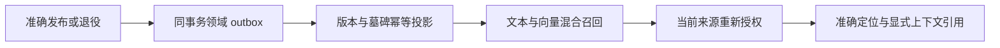

# 下一切片：知识语义投影与外部同步

版本：1.0.0；状态：后续待实现；负责人：平台集成；更新：2026-11-02。本页维护 T196 之后的剩余边界，不将关键词发现与语义索引、同步或模型效果合并验收。

## T196 已贯通的范围

已发布 memory／spec／skill 的关键词发现、准确修订预览和明确选入原任务上下文已限定贯通；CLI 与 Agent 复用同一发现合同和当前权限。真实 HTTP／SQLite 链路验证了发布与新草稿隔离、准确引用、不可变历史以及重新发布后旧任务依据拒绝启动。界面最终收口与实际证据以[限定验证报告](../quality/knowledge-discovery-verification.md)为准。

发现接口采用当前读、有界候选扫描和明确 continuation，不提供全项目假 total，也不声称跨请求一致快照。原[合同](../../contracts/knowledge-discovery.md)、[项目知识](../../contracts/project-knowledge.md)、[交付提炼](../../contracts/delivery-knowledge.md)及[原生技能](../../contracts/codex-native-skills.md)继续作为权威；不重建 T172／T173。

## 当前仍存在的准确断点

| 当前实现 | 剩余边界 |
| --- | --- |
| `ProjectIndexes`，`internal/platform/projector.go` | outbox 载荷按 Record 解析，尚未承载项目知识的领域来源与发布修订。 |
| `SearchIndex`，同上 | 外部命中仍按 documents 原件重新授权，尚不能接受带项目知识身份的语义命中。 |
| `CommandProjectKnowledge` | 发布／退役已有事务、不可变修订和回执，但尚未同事务生成知识索引事件及退役墓碑。 |
| `KnowledgeIndex` | LanceDB／OceanBase 索引、版本和墓碑机制可复用，不能仅因包存在宣称知识发布已自动投影。 |

原 `project.search` 四类记录检索、管理目录的 latest／草稿筛选、已发布关键词发现与语义索引各有独立语义。发布成功不等于索引追平，关键词命中不等于向量召回或模型已应用记忆。

## 下一完整纵向切片

1. **领域来源合同。** 明确 tenant／project／来源类型／知识 ID／发布修订／SHA，区分业务变更顺序与发布内容修订；退役不能以修订归零破坏单调顺序。不把知识伪装成 documents Record，不接收调用者自造批准正文。
2. **事务事件。** 发布、重新发布和退役与原 outbox 事件原子提交，固定事件身份、准确内容及来源版本。原回执重放不重复投影；网络调用在业务事务之外执行，不增加业务派发器。
3. **幂等投影。** 复用现有 `KnowledgeIndex` 和 LanceDB／OceanBase 适配器，明确领域命名空间、版本、处理／嵌入模型版本及墓碑优先级。重复、乱序和删除后的旧事件不能复活来源；分代重建在完整校验后切换，保留可核对进度与失败项。
4. **混合检索与当前授权。** 文本和向量结果统一绑定原来源，再按当前租户／项目权限、发布指针、修订、SHA、退役状态和原来源资格重新解析。不能直接信任外部片段、旧索引权限或草稿加速列；后续任务仍由 `resolvePublishedKnowledgeTx` 复核准确引用。
5. **可解释结果。** 返回准确修订与段落／字符区间等 locator，预览使用原不可变正文。分别展示业务提交位置、实际索引水位、处理版本及查询覆盖；空结果、滞后、部分覆盖和服务失败不混为“项目没有知识”。用户明确选择后才进入原任务上下文，不自动启动模型或任务。

## 交互与必要验收

沿用 T196 的检索、预览与任务选择入口，按需展开“索引状态与来源”，不新增重复配置中心。中文／英文、键盘、窄屏、加载／失败／无权限与旧响应隔离继续复用；原 16 引用、32000 UTF-8 输入及历史证据边界保持。

验收聚焦新增投影：业务提交后进程中断、重复／乱序事件、退役后旧事件、嵌入版本变化、重建切换、来源更新／撤权后的旧命中，以及准确 locator 与水位。以一个受控发布→投影→检索→预览→原任务引用链证明该切片，不重复关键词发现、提炼或技能物化的未变整套检查。真实 LanceDB／OceanBase 环境与协议夹具分别记证。

外部专业记忆同步另行定义连接授权、远端稳定身份、方向、版本冲突、删除传播和原操作恢复；单向索引投影不能冒充双向同步。真实模型应用、随后代码结果与独立质量证据、物理多机、离线协作及其他原生技能格式继续独立交付，不由索引、目录或回合 ACK 推导。

## 范围与证据

知识完整待办仍见[实施计划](implementation-plan.md)。58／34／92 是保留范围基线，当前 checkbox 与基线不等，待稳定 ID、需求及证据映射；不据此删减原 31 项需求或关闭完整 P0–P7。

*English: T196 delivers bounded keyword discovery of eligible published memory, SPEC and skills, exact preview and explicit task-context references, with CLI and Agent consumers. The next slice is typed transactional publication events, idempotent semantic projection with tombstones, currently authorized hybrid retrieval, exact locators and truthful index watermarks. External memory synchronization, verified model application and physical multi-host operation remain separate deliverables.*
