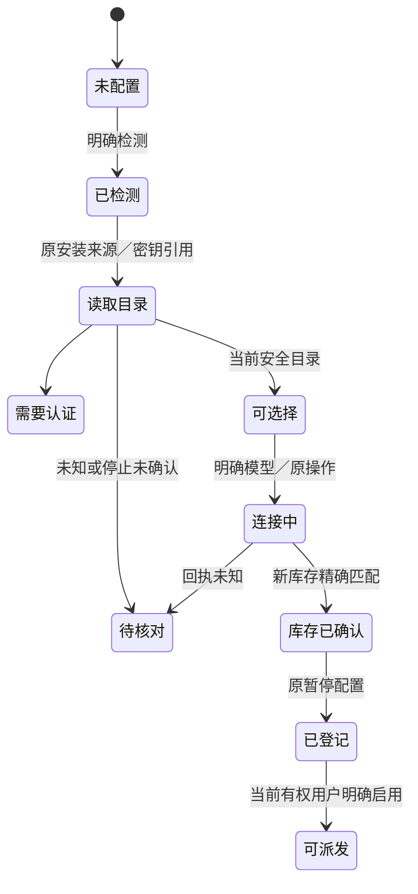

# Cursor ACP 接入与运行交互

T-CURSOR-ACP-189；suma 1.0.0。关联[产品](../product/cursor-acp-execution.md)、[合同](../../contracts/cursor-acp-execution.md)与[限定验证](../quality/cursor-acp-execution-verification.md)。

## 一个接入面板

复用工具快捷接入和 ACP 消费者。选择 Cursor 后依次检测安装、填写本机密钥环境变量名、明确读取模型、选择实际 ID并确认连接；复杂来源与技术细节默认折叠。安装标签、完整版本及当前状态可读，页面不接受任意 argv 或密钥值。

模型目录缺失、认证要求、仅包装器、工作区依据变化、过期、未知和停止未确认分别说明。旧被动观察只能作提示，不能变成模型目录或执行资格。模型读取是独立明确操作，不随 GET、焦点或定时刷新创建会话。

状态图描述用户事实，不把连接、登记和启用压成一个成功状态。没有桌面桥时引导目标 Runner 配置；当前电脑的观察不描述远端机器。

## 原开发界面

任务、讨论开发与专家团队显示同一个固定工具模型和观察型预算说明。预览冻结任务、流程、知识及技能依据；Start 是另一次明确操作。组织或项目 enforce 不可用时展示服务端原因，不提供虚假硬预算表单。

节点沿原一次权限卡显示工具标题、安全细节和准确原选项，只有 allow_once／reject_once。始终区分决定已保存、原生执行事实、停止、候选、独立测试和验收。未知或不支持请求不自动批准，工具通知不转成任务操作。

恢复绑定原 adapter、账号、组织、项目、安装／模型、正文和操作键。先恢复原操作再处理新草稿；过期目录不能覆盖仍待核的旧连接。切换身份／项目、撤权和迟到响应按原 scope／epoch 门清空或拒绝旧内容。

中英共用可扩展类型与词条；输入有标签，键盘顺序及加载／冲突反馈沿原组件，窄屏单列，长模型名和来源可换行。权限、连接及其他讨论动作共享准确 busy 状态，避免彼此提前解锁。

本轮受控完整链与真实厂商无账号探测分别记证；界面不得把初始化或安装观察显示为真实模型可用、持续在线或正式客户验收。
