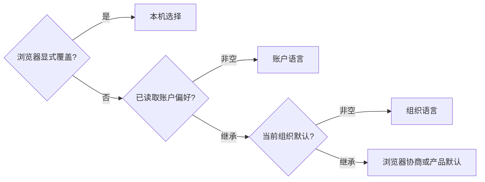

# 持久语言设置与领域国际化

状态：T-P4-007本机验证通过；负责人：平台与工作台。接口和恢复语义见[合同](../../contracts/locale-preferences.md)，范围见[验收报告](../quality/locale-preferences-verification.md)。统一信息架构沿用现有紧凑工作台与Radix基础组件，不向外部设计服务上传项目。

## 使用路径

“组织与项目设置 → 语言与偏好”展示当前有效语言及来源，然后分别呈现个人账户和当前组织设置。两张卡片独立读取、独立版本、独立草稿；账户数据失败不伪装为空设置，组织无权只读时仍可设置个人语言。

顶部快速切换继续提供中文、英文和“跟随默认设置”。快速切换的来源明确为本浏览器；设置页可取消该覆盖。保存账户语言后依然保留浏览器显式覆盖，并解释实际优先级，避免显示“已切换”却未改变界面。

读取失败显示未知及重试；图中的“继承”必须来自有效读取的空值。其他已验证来源可用于临时展示，不能把失败读当作保存的空偏好。来源描述、重试和保存提示使用同一目录。

## 操作与可访问性

原生语言下拉框有独立可访问名称，保存、取消和重读为原生按钮。卡片在窄屏纵向排列；长组织名、操作标识和错误可换行，不挤压语言入口。输入变化后保留焦点；语言变化仅更新标签，不重置选择、未确认信封或版本。

未知写入显示原范围、原语言和原版本，只能恢复原操作。若服务端已确认而恢复存储清理失败，提示已确认事实，保留同一恢复入口。冲突时保留草稿，明确重读后才能提交新版本。退出或切换组织不让迟到回复写进新卡片。

另一个标签页切换登录组织会改变共享Cookie，不能仅靠本页标签或事后响应校验保护写入。提交带原用户及原组织期望头，后端在事务内比对；不一致时阻止修改并提示重新确认上下文。恢复得到的旧回执与当前设置分开显示，既有较高版本不被迟到写入或历史成功响应覆盖。

## 文案分域与门禁

基础目录保留现有键；开发执行、协作排期、偏好等领域在 `i18n/locales/domains/<domain>.<locale>.json` 提供成对目录。运行时使用本地eager导入，保证断线中的语言切换无需远端请求；这增加初始文案体积，后续性能验收需按真实包测量。

领域键以领域前缀开头，基础与领域之间禁止静默覆盖；缺语言、重复键、插值不一致、未审核Trans标签及不完整复数族导致检查失败。运行时也检查配对、命名空间、非空字符串与重复键。原始用户内容、代码、工具输出和不可变证据不翻译。

三个既有服务端策略备注原文作为不可变过滤标识保留；检查只按所属变量及精确摘要排除，不允许扩展为任意中文白名单。显示文案仍在目录中。其余未迁移模块逐项列入旧文案基线，数量是待审查字面量候选，不能当成完整功能数或翻译覆盖率。
