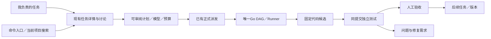

# 个人协作工作台与上下文导航

状态：T-MULTICA-136；负责人：工作台／协作领域。关联[线合同](../../contracts/my-work.md)、[参考采用](../integrations/multica-adoption.md)及[限定验证](../quality/multica-collaboration-verification.md)。这是生产组件与当前读取的设计，不把架构样稿当真实集成。

## 信息架构与日常路径

开发默认进入“我负责的任务”，任务全量管理仍是独立任务页；刷新、分享和返回由既有URL恢复项目、子页、文字和状态。顶部明确当前人员资源、读取时间及完整筛选数量；任务行展示正式业务状态、需求来源、更新时间和工作区入口。状态条件由完整服务端计数驱动，不以已加载数量作总数。草稿及当前自定义状态保留在All，不因前端枚举缺失丢掉其他任务。

个人任务是已有任务的当前投影；没有另存一份任务，也不改派、调度或验收。没有人员资源时展示建立／核对资源入口；资源失效时解释原因。资源管理和工作区都继续执行当前服务器授权。

## 交互与视觉规则

沿用Suma现有明暗主题、正文排版、间距、焦点和状态令牌。个人页用清晰标题、单行搜索、可换行状态筛选与轻量行列表，避免堆叠图表；数量、状态和来源文本分别表达。窄屏行布局转为纵向，主要任务链接与工作区按钮保持可触达。加载、空集合、未绑定、失权、查询失败与分页变化分别提示。

命令面板采用已安装Radix Dialog承载，输入保持焦点；当前页面、其他页面、当前项目对象分组，激活项有可辨识背景及ARIA状态。键盘方向／Home／End移动，Enter执行受控导航，Escape只关面板。导航被未保存保护拒绝时保留面板和输入。短暂指针交互不抢走输入焦点；关闭交由既有弹窗焦点恢复。

输入修改立即使旧业务结果不可激活；250ms防抖、AbortSignal、请求代次和查询身份共同控制回写。最近入口只保存静态页面ID的内存记录；切换账号、组织或项目重置，不将对象标题或片段放入本地持久存储。错误可明确重新读取，不显示为“没有结果”。

## 模块与扩展边界

`internal/platform/my_work*`复用当前权威事务和规范人员绑定，SQL统计与记录分页同事务读取；只增加普通查询索引。`MyWork`及其纯模型控制当前范围、页合并和用户入口；`CommandPalette`及纯匹配模型控制键盘、搜索、焦点与安全导航；App仅连接路由、已加载身份及既有离开保护。

中英目录由现有域glob加载，关键词别名也进入翻译目录，后续语言不需改组件判断；姓名、需求标题、自定义业务状态和历史证据保留原文。命令目录与管理导航共用正式入口，后续可增加明确只读动作，但执行、审批、费用和生产动作必须沿各自版本化领域合同，不从模糊搜索直接触发。

本轮不提供个人审核分配、完整通知／归档、交接收件箱、全项目分组分页或新的智能执行器。桌面、单机浏览器、私有化和SaaS继续复用同一控制面和读取合同；真实跨平台、浏览器和供应商验证以报告为准。
