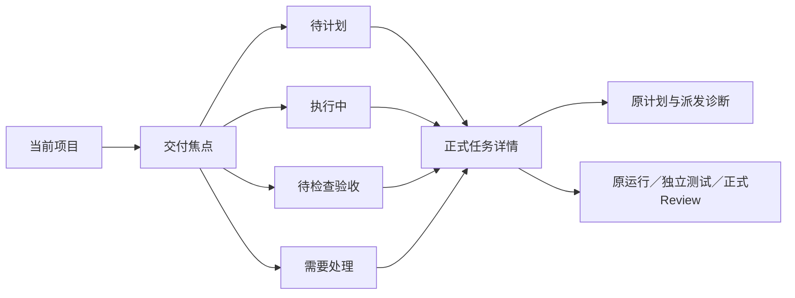

# 项目首页交付焦点

状态：T-EXPERIENCE-133，1.0.0。负责人：产品／工作台。依据：[需求与领域边界](../product/enterprise-workbench.md)、[读取合同](../../contracts/project-focus.md)。当前渲染、组件和服务证据分别见阶段报告。

## 信息层级

首页使用现有字体、主题变量与紫色强调色。项目背景、全量交付进度与分页关注队列构成主要工作区；“任务计划与执行依据”作为默认收起的诊断，展开后才读取四类任务。风险、应用、里程碑、团队与运行入口保留。

四类筛选显示服务端全量计数，每类最多6条紧凑明细；“显示X／共Y”及“全部任务”说明范围。不存在完成率饼图或由首批数据推算的百分比。选中筛选有文字／按下状态，颜色只辅助表达。每个任务整行为一个可键盘操作按钮，包含标题、优先级、业务状态、真实运行状态、版本、固定原因及实际更新时间。

## 关键状态

| 状态 | 当前交互 |
| --- | --- |
| 初次读取／刷新 | 诊断默认收起；展开后明确加载，不展示虚构零计数；诊断刷新只影响本域读取 |
| 单类空 | 在该分类解释暂无项目；其他分类仍可选 |
| 全部空 | 单一空态和需求入口；仍提供所有任务，不能推断项目完成 |
| 错误／无权／无效来源 | 暂时503不耦合主概览与按需诊断；主概览或关注队列已知失权时共享拒绝状态并卸载私有主视图与诊断 |
| 切换项目／身份 | 清除旧快照，忽略迟到结果；项目变化重置分类 |
| 切换语言 | 保持当前筛选和焦点，不重复读取业务数据 |
| 运行成功但任务已变 | 原依据变化进入待处理；不沿用旧运行显示待验收 |

窄屏使用单列任务信息与可换行筛选；操作目标保持可触达，长标题／原因换行，不要求横向滚动。减少动效时取消交互过渡。当前DOM行为验证不代替真实视口、字体、主题及浏览器绘制验收。

开发工具的另一主要入口采用[客户端接入设计](developer-clients.md)：先选客户端，再核对项目／地址与配置片段，最后在实际客户端验证；配置导出与平台可调度执行分别表达。
