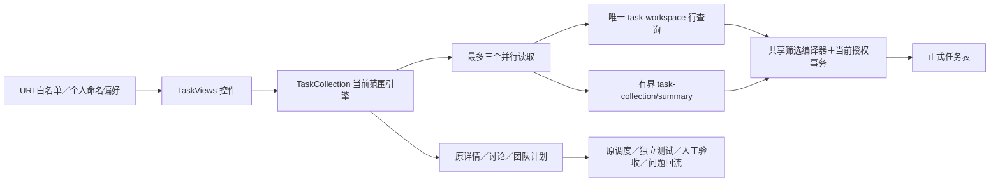

# 任务工作台：统一视图与有界分组

状态：T-TASKS-137；负责人：规划领域／体验；产品1.0.0。关联Multica M06／M07、项目进度和团队派发。正式数据合同见[统一查询](../../contracts/task-workspace.md)，实现为TaskViews、TaskCollection、task-collection-hooks/model；[限定验证](../quality/task-collection-verification.md)记录实际证据。

## 用户流程与简洁布局

项目→开发→任务只设一个入口。顶部保留新任务、依赖、团队安排和刷新；视图控件负责命名偏好、列表／看板、排序和分组。高级筛选默认折叠，窄屏可展开；展示搜索、业务状态、负责人、优先级及需求，未分配／未设置显式表达。范围说明收进details，避免技术信息占据主界面。

列表展示完整匹配总数、当前已加载和读取时间；看板按状态／负责人／优先级展示真实分组总数和每列已加载量。默认只加载20个组，更多组必须明确点击；每列独立继续加载，读取同时最多三个。完整数与当前窗口分开，未知数据不绘制假进度。空态可清除筛选或新建；503保留其他列并提供本列重试。

中英文使用同一领域词条和状态组件；系统标签翻译，用户定义的状态／优先级保留原文。按钮具有明确名称、键盘焦点和忙碌禁用；窄屏不要求通过拖动更改业务状态。浅深主题复用现有设计令牌，减少动效时不依赖动画传达结果。

## 模块边界

TaskViews是控制与偏好层，通过renderContent组合正式引擎，页面不再并列两种规则不同的任务入口。可复用的独立TaskViews呈现器保留历史授权来源的窄范围分组适配及归属说明；其已加载分组结果不冒充服务端完整数。当前Multica源码不直接搬入，来源见[复用清单](../integrations/multica-reuse.md)。

## 交互状态与竞态

| 事件 | 界面行为与依据 |
| --- | --- |
| 条件、排序、分组改变 | 只提交白名单偏好；清理旧分页、取消旧读取，保留原任务详情导航约定 |
| 点击更多组／列中更多 | 使用各自游标；已加载内容保留，禁止自动拉完整项目 |
| 同一任务跨列移动 | 保留更高版本一次；同版本冲突提示刷新，批量选择不沿用旧版本 |
| 统计变化 | 展示不同读取时点和刷新入口，不伪装冻结快照 |
| 单列503 | 本列错误＋重试；其他列继续可用 |
| 401／403／404范围拒绝 | 清空列表、详情、编辑、选择、查找结果与排队读取；旧身份拒绝不会污染新身份 |
| 本地偏好存储损坏／跨标签变动 | 提示并允许重载／继续当前视图，不静默覆盖用户操作 |
| 刷新与返回 | URL保留合法当前筛选；显式项目／身份切换重置该范围的私有条件 |

## AI开发与验收SOP

1. 先明确此变更属于只读查询、偏好还是正式业务命令；不在界面复制调度或审批规则。
2. 查询字段从同一编译器／合同生成；空字段与不限范围分别建模，不设all或资源ID哨兵。
3. 新异步读取绑定账号、组织、项目、筛选、排序、分组及刷新代次；异常先分类权限／瞬时失败／游标失配。
4. 只围绕改变的合同、分页、竞态、权限和用户路径做必要验证；保存真实失败与最终源文件摘要，不反复运行无关全套。
5. 检查同源类型、双语目录与隔离生产构建；浏览器实际检查另记证据，不以DOM用例替代视觉结论。
6. 审核准确文件清单后阶段commit／正常push dev；排除缓存、数据库、截图、安装包和他人暂存内容。

后续：共享视图／服务器同步、跨项目组合、虚拟化万节点／百万任务实际性能、所有工具真实接入与生产范围仍按[原计划](../delivery/implementation-plan.md)交付。

本机视图仅识别明确的 `format: "suma-task-views-literal-v1"`。无当前标识的数据原件保留并提示显式恢复，不推断资源字段的旧含义、不迁移或自动覆盖。
