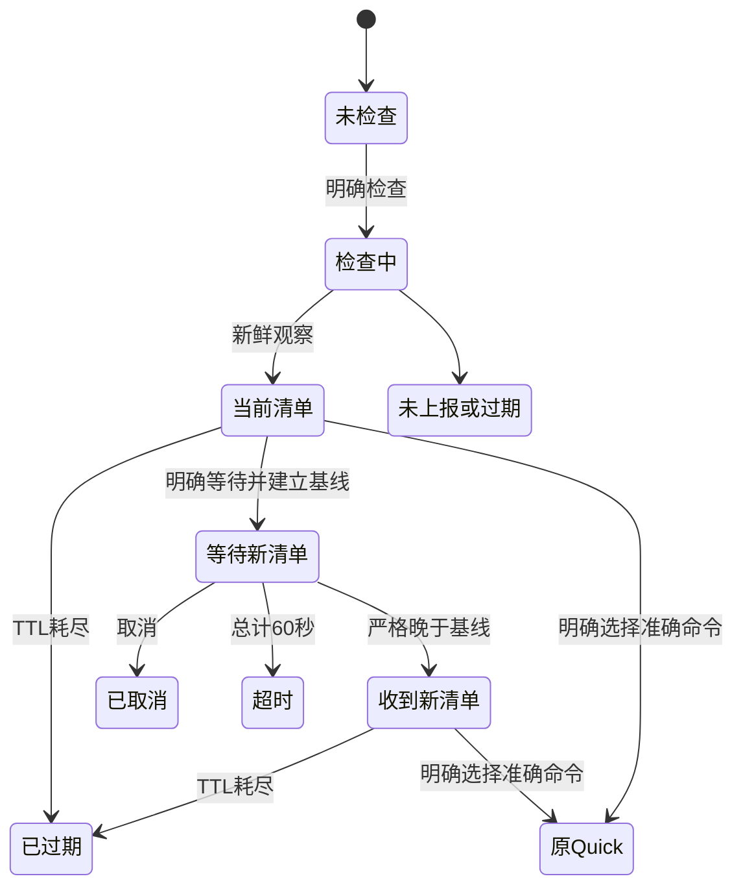

# 工具上报反馈交互

版本1.0.0；T-TOOL-REPORT-FEEDBACK-204；负责人：工作台代理／主集成代理；状态：本阶段实现与限定验证通过。关联[需求](../product/tool-report-feedback.md)、[架构](../architecture/tool-report-feedback.md)。

## 信息层级

反馈放在原指南的上报步骤，保持一处操作。首行给出当前状态，随后提供“检查上报”和“等待新清单”；等待时显示取消。准确命令条目在当前新鲜观察内提供“核对配置”，不可用时展示正式原因。不增设多页向导或新的连接面板。

编辑字段、采用新配置或切换调用者立即撤掉旧内容。等待结束不自动打开Quick、不自动复制、不自动登记。断网给出“无法确认”的状态，权限失效清除观察，保留原指南公开草稿。

## 布局与可访问性

使用现有设计令牌、原生按钮和状态区域，局部控制高度44px。宽屏按钮自然换行，390px窄屏垂直排列；长节点、命令和原因可换行。状态变化通过适当live region读出，焦点保持当前操作，明确返回可用键盘触发。中文与英文使用同一语义键，不把状态枚举或原始错误作为面向用户文案。

“当前清单”和“收到新清单”使用不同文案；接收时间不写作执行完成。剩余资格到期后立即禁用条目，不依赖用户恰好再次查询。减少动效设置沿全局规范，不用循环动画表现未证实进度。

代表状态与实际边界见[限定验证](../quality/tool-report-feedback-verification.md)。
