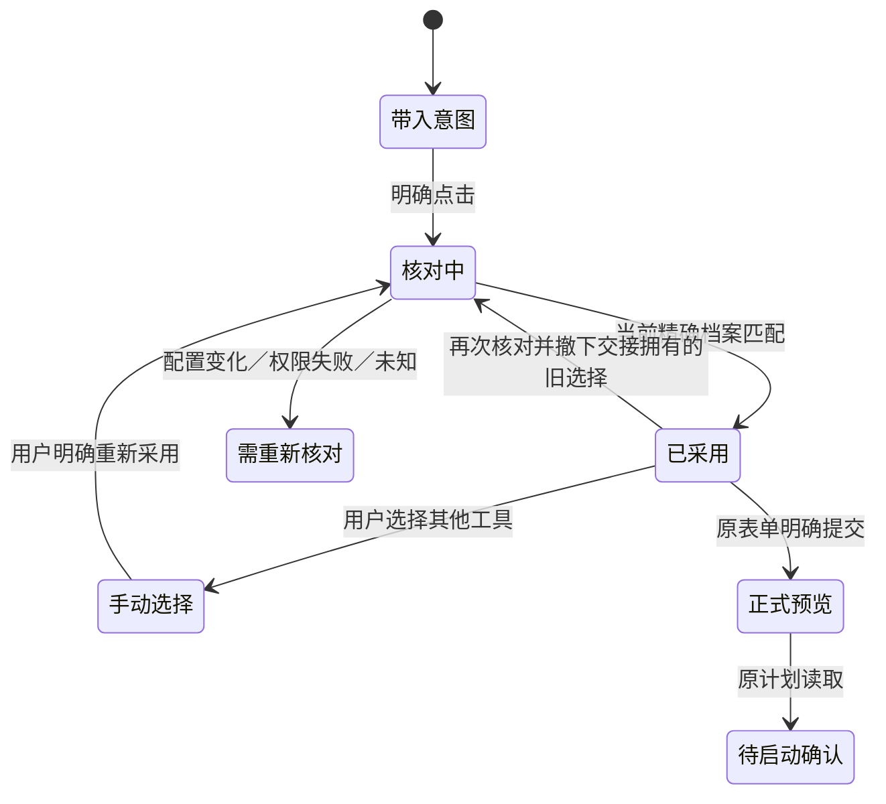

# 工具任务交接交互规范

版本：1.0.0。阶段：T-TOOL-TASK-HANDOFF-213。状态：实现已落，代表界面结果见[最终质量报告](../quality/tool-task-handoff-verification.md)。负责人：工作台／任务派发。关联：[产品](../product/tool-task-handoff.md)、[架构](../architecture/tool-task-handoff.md)、[唯一合同](../../contracts/tool-task-handoff.md)。完整31项／P0–P7继续。

## 信息层级与操作顺序

工具详情保留原 Doctor、配置调整和启停动作。符合当前条件的准确档案增加一个“用于任务”入口。任务列表按需出现，选择后进入原派发界面；不同时叠放两个 Modal。

任务选择保留原检索、已加载范围、更多和刷新。行选择仅定位目标；继续之前重新读取任务及工具。没有当前权限、列表为空、目录读取失败和工具变化分别呈现，不用空态代替失败。

派发表单在任务／流程／Agent节点确定后显示一张简短工具卡片：名称、版本、Worker、一项“核对并采用此工具”操作和状态说明。原候选、工具选择、模型预算和知识保持原位置。卡片不给出任务已可执行的结论。

## 状态文案与恢复

| 状态 | 交互规则 |
|---|---|
| 已带入 | 展示定位意图，尚未采用，不自动发请求 |
| 核对中 | 禁止重复采用，短状态说明读取准确工具 |
| 已采用 | 与父表单实际选择一致；引导核对下方模型与预算 |
| 配置变化 | 告知原依据变化，不默默切换版本或同名工具 |
| 权限不可用 | 不采用旧响应，保留可理解的返回原详情路径 |
| 网络未知 | 由用户明确重新核对，不自动发起写入 |
| 原写入待恢复 | 保持原恢复提示与锁定，原操作优先 |

手动选择 B 后，卡片不再声称 A 已采用。重新核对失败只撤下交接拥有的 A，不清除 B。任务、流程或节点变化使旧选择失效；带入意图保留供明确重核。

## 键盘、窄屏与国际化

- 检索、选择、继续和采用遵循 DOM 顺序，原生控件保留键盘语义及清楚的焦点轮廓。
- 操作目标最小44像素，窄屏采用单列，工具名称和节点标识允许换行，不依赖横向滚动完成操作。
- 关闭任务交接回到原工具入口；显式定位与 Modal 默认回焦协调，不把焦点留在已卸载或折叠内容。
- 短状态使用可感知反馈；采用与读取分别表达，不通过动效制造执行进度。
- 中文／英文词条成对维护，数字沿原本地化组件呈现。原始名称与标识是业务值，不作为可翻译枚举。

## 代表验收

覆盖首目录页外工具、任务重读、准确采用、手动选择、变化／拒绝／未知、来源 ABA、关闭回焦与原预览恢复。当前阶段实际检查任务选择和正式预览，不重复启动执行链；真实运行、模型、独立测试与验收是否发生分别记录在最终质量报告。
