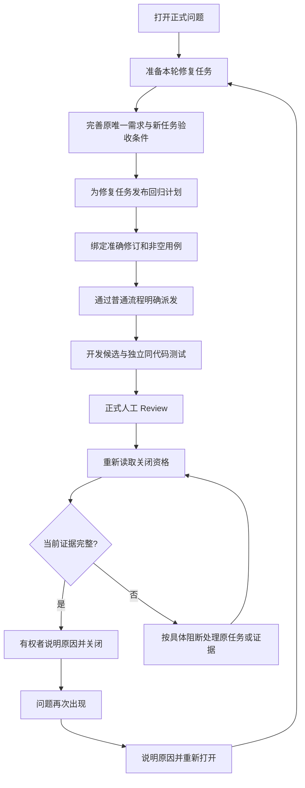

# 问题修复闭环：使用指南与 AI 开发 SOP

适用：速码 **1.0.0**，**T-QUALITY-119**。负责人：质量领域与工作台。关联：[领域架构](../architecture/issue-repair.md)、[接口合同](../../contracts/issue-repair.md)、[测试计划指南](test-plans.md)、[任务交付链](task-delivery-chain.md)、[English](../en/issue-repair.md)。本文说明当前操作合同，不表示你的项目已通过修复、生产或规模验收。

## 一次修复如何完成

在当前项目的问题详情内完成准备、回归绑定及关闭，无需额外问题控制台。开发仍进入原任务工作台，测试仍使用原测试计划和质量页，Review仍由当前有权者完成。界面操作资格来自最新 `IssueRepairView` 的 `can_*` 和 `blockers`。

### 1. 读取问题和实际来源

先确认当前账号、组织和项目，打开原问题及关联运行／用例证据。测试问题的正式来源来自原测试计划保护关系；问题描述中的 `run_id`、`case_key` 或同名任务不是充分证明。

读取 `GET /api/v1/issues/{id}/repair?project_id=…`。没有准备记录时会显示当前轮次，但不会因为打开页面自动建任务。当前轮次单独显示，关闭后仍含其closure；旧轮次的 `history_total/history_complete` 不包含current，列表最多10项，不把局部列表写成全部历史。

### 2. 准备本轮普通修复任务

填写修复任务标题、说明、负责人、非空验收条目及操作原因。负责人设置遵循当前项目成员规则。提交时携带当前 `expected_issue_version` 和稳定操作key。

系统沿用问题已经存在的正式回流需求；没有则通过原IssueIntake建立需求草稿。需求、该轮新任务、保护关系及回执同事务保存。它不会覆盖既有需求正文，也不会自动批准、派发、启用工具、调用模型或预留预算。

修复任务是可在原任务工作台查看的普通任务。需要调整需求范围、基线或负责人时使用原领域操作；这些变化可能使已经发布的测试计划依据过期，应先处理来源再继续。

### 3. 发布修复任务的回归计划

为新修复任务创建或完善测试计划，写清前置条件、步骤、预期结果、覆盖条目及真实报告selector，然后明确发布。草稿不是可绑定修订。

如果问题来自某个失败测试用例，新计划必须包含原 `case_key` 和完全相同的 `selector.class_name/name`；仅用相似标题或新key描述同一问题不满足要求。可以增加其他回归用例，但不能删除原失败项来获得通过。原报告及失败状态保留。

### 4. 显式绑定回归范围

选择属于本轮任务的计划，勾选非空回归用例集合。提交 `plan_id/case_keys` 与当前问题、修复和计划的预期版本。服务器解析并固定当前发布的 `plan_revision/plan_sha256`，页面应显示准确修订与摘要。

`expected_plan_version` 是用于并发检查的计划版本，不是发布修订。不要手工填造SHA或提交 `passed`。任务、需求或发布依据变化时，不会默默切换为“最新版本”；重新读取资格并明确处理。

### 5. 走原开发、独立测试和 Review

通过原任务派发流程选择固定工作流、工具、模型与预算，审阅计划后明确启动。原生Suma、Octop及其他已批准工具使用同一任务交付与质量合同。

开发候选需要由独立测试节点／工作树测试，报告绑定确切代码、节点、attempt和fence。Agent的开发检查、退出码0、DAG绿色和自然语言“已修复”均不能替代。查看逐例结果；缺失、跳过、模糊匹配、旧代码和未知结果都不能自动通过。

流程中保留明确的 command／agent修复生产者及测试节点的 `candidate_from`。生产和测试选择不同Worker身份；平台核对调度器原候选pin及当前双方证据。单独跑一个绿色测试、同一Worker完成开发和自测，或使用尚无等价候选证明的复杂来源，均不能作为本轮关闭依据。自有确定命令可以真实执行修复，但不能将其描述成已调用AI厂商。

使用确定命令时保留command节点并绑定当前已授权的 `command/text-v1` 工具档案，核对当前库存和指纹。不要改成agent、移除profile或自行拼接结果来避开门禁。map／subworkflow来源尚未具备等价证明时，按readiness提示阻止，不把绿色父流程当成完整修复证据。

由当前有权者执行原正式Review。准备或绑定回归不会代替Review，也不会把已有旧Review套到新的运行或计划上。

### 包测试问题的复验

问题详情会显示原失败制品、执行尝试与适用的应用代码范围。为本轮修复配置原独立包测试命令，重新构建并封存制品。保留 JUnit 节点和独立包测试节点；包测试 Runner 与构建 Runner 分开。应用级修复可以用新源码版本，但要匹配原应用范围和 Git 目标。只有 JUnit 通过时，问题仍提示缺少包测试复验。

正式 Review 后，打开问题详情核对关闭资格并填写关闭原因。关闭时会保留复验用的制品和执行链接。重新打开后，可以在历史轮次同时查看原失败来源和已保存的复验依据。

关闭轮次的证据仍有效时，可从问题详情进入发布候选。页面先显示并锁定本轮已验收任务和制品证明，填写名称后明确创建。候选详情可以回到原问题。若问题在此期间重开，应返回当前修复轮次处理；已创建候选保留历史记录，后续正向发布资格重新核对。

### 6. 重新读取资格，再人工关闭

刷新本问题修复视图，查看当前任务、运行、绑定修订、所选回归用例和阻断。`can_close` 只是当前显示资格；提交Close时服务器还会在同一事务内重新核验。

Close需要当前浏览器身份及Review权限，提交确切当前 `run_id`、预期问题／修复版本、原因和原操作key。通过后记录实际Review、任务版本、计划修订与SHA、代码提交及关闭人。关闭不改写原失败运行，不自动关闭其他问题、批准发布或部署生产。

### 7. 再次出现时重开，不改旧证据

有权者填写原因后Reopen。旧关闭快照和旧任务继续可查，问题回到open，cycle增加；新轮次在Prepare前没有current任务。再次Prepare会建立新普通任务，沿用原唯一回流需求，不修改已验收任务来遮盖复现记录。

## 常见阻断与恢复

| 情况 | 正确处理 |
| --- | --- |
| 未准备／问题已关闭 | 按服务端资格Prepare；已关闭需由有Review权者明确重开 |
| 未绑定／原用例不在范围 | 发布本轮任务计划，包含原key及原selector，再明确绑定 |
| 计划发布或任务／需求依据已变 | 保留旧修订及结果，重新核对当前来源；必要时重做原任务测试和Review |
| 任务未验收／缺正式Review | 回到原任务交付页处理，问题页不能自行制造批准 |
| 指定运行已经变化 | 核对当前任务真实运行，不选另一条绿色运行绕过 |
| 用例失败、缺失、跳过、模糊或未知 | 打开准确用例及原报告处理；未知执行先核对原操作 |
| 版本冲突 | 保留表单，重新读取当前版本并审阅差异；不是直接改为最新版本强制提交 |
| 请求超时、回执丢失 | 保留同一个操作key和完整载荷，恢复原请求；恢复成功后GET当前事实 |
| 已撤权或切换账号／项目 | 停止旧作用域操作并重新授权，清除旧页面事实；不能用缓存继续提交 |

所有受控标签、阻断和操作说明支持中文和英文；标题、原因、测试文本和证据原文保持用户原语言。语言切换不创建新命令、修改selector或重置请求身份。

## AI 开发 SOP

### 输入与计划

1. 从当前问题及正式保护来源读取范围，记录issue版本、当前cycle、来源任务／运行／用例。不得从可编辑Data猜关系。
2. 核对是否已有原唯一需求和当前轮次任务；不重复创建问题、需求或修复任务。
3. 提出可审阅修复说明、明确验收条件与回归范围。项目知识／技能只引用已审核的固定修订，不因此获得代码、工具或审批权限。

### 实施与证据

4. 在明确授权的范围内，使用当前浏览器或项目API准备任务及绑定回归；先读取版本，保留操作key。API不能伪装为浏览器Review身份。
5. 开发沿原任务派发、唯一DAG和受控工作区进行。修复依据或模型预算不足时明确阻塞，不自动增加权限、换模型或重跑未知操作。
6. 收集独立测试与正式Review的实际结果；将开发检查、模型建议、执行事实和批准分别呈现。禁止改报告、case状态、问题Data或通用status让门禁“通过”。

### 关闭与复现

7. AI可以汇总当前关闭资格和未满足条件，不能自行完成Close／Reopen的人审门禁。由当前有Review权限的浏览器用户提交明确决定。
8. 若超时，恢复同一原操作；若来源漂移，保留原事实并重新核对。关闭后的新问题表现使用Reopen与下一轮任务，不改写历史闭环。
9. 交付记录包含本轮任务、原唯一需求、回归修订／SHA、实际运行、Review与受测提交的链接。未验证事项明确列出，不能从文档或模型输出推定通过。

## 开发维护约定

后端扩展 `issue_repair` 领域服务与当前授权事务，前端在原问题详情内提供一张简洁卡片及按需展开的证据。接口类型从权威Go DTO生成，不在客户端维护第二套状态或判断公式。

必要检查覆盖同操作重放、跨项目／撤权、并发准备、原用例要求、发布漂移、缺失Review、独立证据、通用旁路及重开历史；只验证本轮改动与代表性用户旅程。缓存、真实运行目录、数据库、凭据及临时报告不进入Git，阶段提交只纳入源代码和必要文档。
