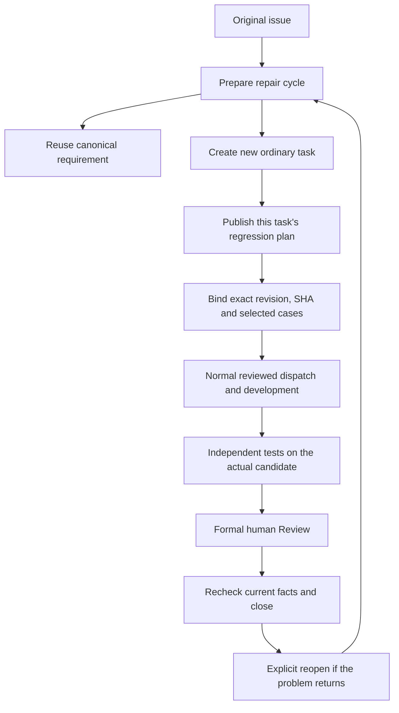

# Issue repair, regression and closure

Applies to **suma 1.0.0**, **T-QUALITY-119**. Owners: quality, task delivery and workbench. [中文操作与AI SOP](../development/issue-repair.md) · [Architecture](../architecture/issue-repair.md) · [API contract](../../contracts/issue-repair.md) · [Test plans](test-plans.md). This document describes the implementation contract. Actual verification and delivery records remain separate; documentation does not certify a repair or production release.

## One issue, one requirement, a new task for each cycle

The repair flow extends the existing issue details. It reuses normal tasks, workflow dispatch, model bindings, isolated candidates, independent test reports and formal Review. It does not introduce another dispatcher, issue tracker or approval system.

Each issue keeps its original canonical intake requirement. Preparing a repair reuses that requirement, or creates its draft through the existing intake domain if none exists. It creates a **new ordinary task** and a protected repair relationship in the same authorized transaction. It does not overwrite an existing requirement, approve it, dispatch the task, reserve model budget or start execution.

Issue states are `open`, `in_progress` and `closed`. Development, regression and acceptance stages are derived from their actual records. Editable issue data cannot establish repair lineage or passing evidence.

## Operator workflow

1. **Open the original issue.** Check the current account, organization and project. Read its protected source and exact failed run or case. A matching title, editable `run_id` or copied case metadata is not proof of origin.
2. **Prepare the cycle.** Provide the task title, description, project owner, nonempty acceptance criteria and reason. Preserve the expected issue version and operation key. Inspect the returned task rather than creating another one after a timeout.
3. **Publish a regression plan for that task.** A draft is insufficient. For an issue created from a failed test case, the plan must retain the original `case_key` and the exact `selector.class_name/name`. Extra regression cases may be added; changing the title or replacing the selector does not cover the original case.
4. **Bind selected cases.** Choose a nonempty case set and the current plan version. The server resolves and freezes its published revision and SHA. `expected_plan_version` is the plan's concurrency version, not the published revision number. The request does not supply a passing result or a fabricated publication hash.
5. **Use the normal delivery flow.** Select the approved workflow, tool, model and budget, review the dispatch plan and explicitly start it. Native Suma, Octop and other authorized tools use the same quality gates. An agent's workspace check, exit code zero or green graph does not replace an independent report.
6. **Complete formal Review and refresh closure eligibility.** The chosen run must still be the repair task's current run. All selected regression cases need current independent passing evidence for the actual tested code. Missing, skipped, ambiguous, stale or unknown results block closure.
7. **Close explicitly.** A current browser user with Review authority submits the exact run, expected issue and repair versions, reason and operation key. The server rechecks the facts inside the write transaction; an earlier `can_close:true` is not a grant.

Every selected case must trace to the current test attempt, its `candidate_from`, the scheduler's persisted candidate pin, and the current successful command or agent producer. The original attempt, fence, workspace evidence digest and exact source commit must agree. Producer and test Worker identities must differ. A test-only flow, self-testing on the producer Worker, or a `test_from`/complex source without equivalent candidate proof cannot close the issue, even after Review; it yields `repair_evidence_stale`.

A deterministic command producer remains a `command` node bound to an approved `command/text-v1` profile, with current authorized inventory and the original execution fingerprint checked. Do not impersonate an agent adapter or omit the profile. Current readiness blocks map/subworkflow sources without equivalent proof. A real OS/HTTP journey using owned deterministic commands is not evidence of an AI model call.

The closure records the actual run, task version, Review ID, plan revision and SHA, selected cases, source commits, decision maker and reason. It does not alter the original failed report or deploy code.

For a package-test issue, use the original run and artifact links to inspect the failure. Rebuild and seal the repair artifact, then run the original package test profile on a separate Runner alongside the JUnit plan. An application-scoped repair can use a new source revision for the same application, code scope and Git target. The repair must retain verified package evidence as well as the current formal Review. A closed cycle keeps links to the verified package attempt and artifact, including after reopening.

When a closed cycle remains eligible, open its release candidate form from the issue. The form loads the current accepted task and sealed artifact proofs for that exact cycle. Enter a candidate name and confirm creation. The candidate links back to the issue and preserves the handoff. Reopening the issue makes that candidate ineligible for future forward releases, while historical deployments keep their original records.

## Reopen without rewriting history

A browser user with Review authority can reopen a closed issue with a reason. The original closure, task and evidence remain. The cycle increases and has no current repair task until another explicit Prepare. That next Prepare creates a new task while preserving the same canonical intake requirement. An already accepted task is not reused as a mutable repair container.

After closure, the current cycle still contains its closure. Reopening moves it into history. `history` includes at most the latest ten older cycles; `history_total` excludes `current`, and `history_complete` discloses that older-history boundary. Do not label a truncated list as the complete issue history. A protected closed-run reference also prevents reuse of a historical closure's run in a later cycle.

## API surface

| Method and path | Request type / purpose |
| --- | --- |
| `GET /api/v1/issues/{id}/repair?project_id=…` | `IssueRepairView`; current project read |
| `POST /api/v1/issues/{id}/repair/prepare` | `IssueRepairPrepareRequest`; browser or project API write |
| `POST /api/v1/issues/{id}/repair/regression` | `IssueRepairBindRequest`; browser or project API write |
| `POST /api/v1/issues/{id}/repair/close` | `IssueRepairCloseRequest`; browser with Review authority |
| `POST /api/v1/issues/{id}/repair/reopen` | `IssueRepairReopenRequest`; browser with Review authority |

POST bodies include `project_id`, expected versions, a reason and a stable `idempotency_key`. Exact fields are defined by the [Go DTO](../../internal/platform/issue_repair_types.go) and [contract](../../contracts/issue-repair.md). Do not add tenant, cycle, source evidence, commands or approval fields.

The view contains `issue`, `cycle`, optional `current` and `task`, bounded history, `can_prepare/can_bind/can_close/can_reopen` and structured blockers. Reads create no task or run. An action reauthorizes and rechecks its basis; UI eligibility does not bypass the transaction.

Current authorization is checked before restoring an original receipt. Replaying the same key and payload restores its original result before stale-version checks; it does not execute the action again. Read the view afterward for current facts. The same key with different input conflicts.

## Blockers and recovery

| Blocker | Next action |
| --- | --- |
| `repair_not_prepared` | Explicitly prepare the current cycle |
| `issue_closed` | Reopen with Review authority before further repair |
| `regression_not_bound` | Bind a published plan and nonempty case set |
| `original_case_required` | Include the original key and exact selector |
| `repair_task_not_accepted` / `formal_review_missing` | Return to normal task delivery and Review |
| `repair_run_changed` | Inspect the task's actual current run |
| `repair_evidence_stale` / `regression_plan_changed` | Recheck changed scope, code or publication; retain historical results |
| `regression_case_failed` | Inspect exact case evidence; do not assign a passing status manually |

On a version conflict, preserve the form and inspect the current state. On a lost response, retain the original payload and operation key. On unknown execution, reconcile the original operation before rerunning anything. Revoked access, a changed account or another project invalidates the old view's authority.

## AI development SOP

- Read authorized, protected issue sources and current versions. Reuse the canonical requirement and existing current-cycle task.
- Propose a bounded fix, explicit acceptance criteria and regression scope. Reviewed project skills or knowledge remain fixed task data and grant no tools or approval powers.
- Within explicit authorization, prepare tasks and bind regression using the existing browser or project API. Never impersonate a browser reviewer with an API, Agent or Runner credential.
- Develop through normal dispatch and the original Go DAG. Keep model proposals, development checks, independent evidence and human decisions separate.
- Present current closure eligibility and blockers. A human browser user with Review authority makes Close or Reopen decisions.
- Preserve operation identities after timeouts, and preserve earlier cycles after recurrence. Never edit XML, generic issue status or metadata to make a gate pass.

Controlled UI labels, blockers and instructions support Chinese and English. User text, test selectors, hashes and original evidence retain their original meaning and language. A locale change does not issue a new command or reset the operation identity.
