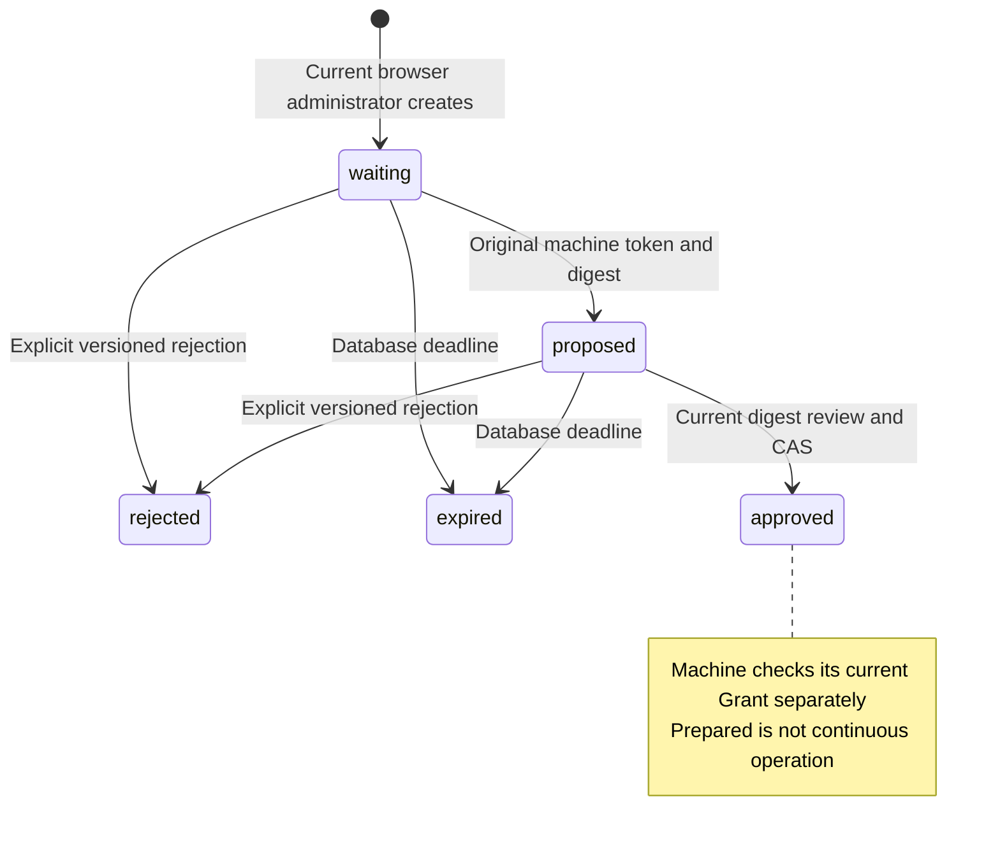

# Remote Runner pairing

T-RUNNER-PAIRING-184, suma 1.0.0. Pairing lets a project administrator approve a remote machine's exact credential digest without typing a Worker ID or copying a token. It reuses the original Runner authority, registration and inventory workflows. See the [contract](../../contracts/runner-pairing.md) and [verification report](../quality/runner-pairing-verification.md).

## User flow

Open the remote-pairing section inside the original Worker registration modal. It is collapsed by default and fixes the current project. Explicitly create a ten-minute waiting request; each project permits at most eight active, unexpired requests.

Select PowerShell or Bash explicitly, review the public connection command and run it on the target machine. The command contains no token and does not run automatically. The Runner first saves its random token in the OS credential store, persists its public identity and original proposal, then sends the digest. The device name is self-reported information, not proof of the machine.

Refresh that same request in the browser. Review the full digest fingerprint and device name, then approve the current version explicitly. A current project administrator is required. The server atomically creates a generated remote-worker and the original independent 24-hour Runner Grant, with no release profiles or deployment capability.

The machine uses its original token to query the original result. Only a still-valid Grant and exact Worker binding allow it to save approved metadata, return prepared and exit. Pairing does not report inventory, enter the Worker loop, claim tasks, send task heartbeats, enable profiles or run work.

After approval, refresh the original Worker list and continue configuration for the exact returned Worker ID. Do not pick the first list entry. Use `--identity PATH` for an explicit original single `--report-tools` operation or a separate deliberate Worker start. Inventory freshness, continuous operation, profile enablement, model login and task acceptance remain independent facts. Approved is a historical decision; prepared is a local identity state. Neither means online.

## State and authority

The single shared DTO contract defines these five states and versions starting at 1. `can_approve` is only a current browser administration observation; machine responses always carry false. Database time determines expiry. The page shows absolute expiry and server state rather than a client-clock countdown or inferred approval permission. Reading does not extend the deadline.

The safe operator-controlled control URL, including its exact path, is fixed at creation. HTTPS is required remotely; loopback HTTP is local only. Host/forwarding headers and client approval bodies cannot select a destination. Approval, proposal and status reject a changed operator URL instead of redirecting or silently adopting another scope.

Browser create and command actions check current real Actor/project administration before recovering a receipt. Approval uses the original CAS and transactionally saves the pairing, original Grant/slot/digest/Runner scope, generated Worker, activity and metadata receipt. The desktop HMAC/loopback API and its original domain hashes remain restricted. No browser, response or receipt receives the machine's token.

The machine cannot create public requests. Proposal and status prove the exact existing locator, project, original operation and token digest; they cannot list projects or inspect another machine. Every approved machine result rechecks current Runner authority and Worker binding. An expired or revoked credential cannot be restored from an old approval. Expiry of the short pairing request does not itself revoke an issued independent Grant; rejection does not revoke an approved Worker.

## Durable identity and original recovery

The fixed dependency `github.com/zalando/go-keyring v0.2.6` adapts Windows Credential Manager, macOS Keychain and Linux Secret Service. Its macOS implementation sends the secret through `security -i` stdin. These three implementations do not establish real-machine acceptance on all three operating systems.

The public `suma-runner-identity-v1` file stores control URL, project, pairing, proposal operation, device name and credential digest; approval adds Worker ID and credential expiry. It contains no secret. The OS-store account is bound to that exact control/project/pairing and identity-file location. Original local locking, bounded strict reads and atomic writes reject linked, damaged or mixed identities. Missing secure storage, an existing identity without its secret or a digest mismatch fails without a plaintext fallback.

On an unconfirmed response, preserve the original identity, token, body and operation key. Restart the same command to recover them. Browser creation recovers its original waiting v1 ACK; approval/rejection recovers that command's original snapshot, followed by a separate current GET. Machine recovery may return current metadata only for the same exact binding and proof. Never issue another token, replace the digest or change a key to hide an unknown result.

For `--identity` reporting or explicit Worker startup, supplied control/project/worker values must match exactly before any network or journal change. Omitted values come from the approved identity. The default journal belongs to that identity, retaining the original inventory scope checks. Renewal and re-pairing require separate explicit authorization.

## Interaction, AI SOP and evidence

Only public locators are saved by user/organization/project. Secrets never enter sessionStorage or generic pending-write storage. Reads use caller/project/abort/stale protection; unknown writes lock the parent modal and prioritize the original recovery. Chinese and English share the same states, actions and facts through the existing localization catalogs, with room for additional languages without alternate authority paths.

AI must preserve the original Actor, project, version, digest, identity and ACK. It must not approve a device on its own, treat a name as proof, or report historical approval/prepared as online. Configuration, inventory, connection, enablement, task execution, independent tests and human acceptance are recorded separately.

Focused backend evidence covers controlled HTTP/SQLite, original identity checks, CAS/receipt recovery, rollback and the concurrent project cap. Root's Windows real credential-store and HTTP checks are pending consolidation in the integration report; injected providers and synthetic components do not replace that evidence. Other OS acceptance, physical multi-host operation, real vendor models, installers, other databases and production remain separate work. The complete original 31 requirements and P0–P7 scope remain active.

Project-scoped identity report drafts also include explicit current control/project assertions. A different saved service or project is refused before network or journal changes; the draft never copies a token.
