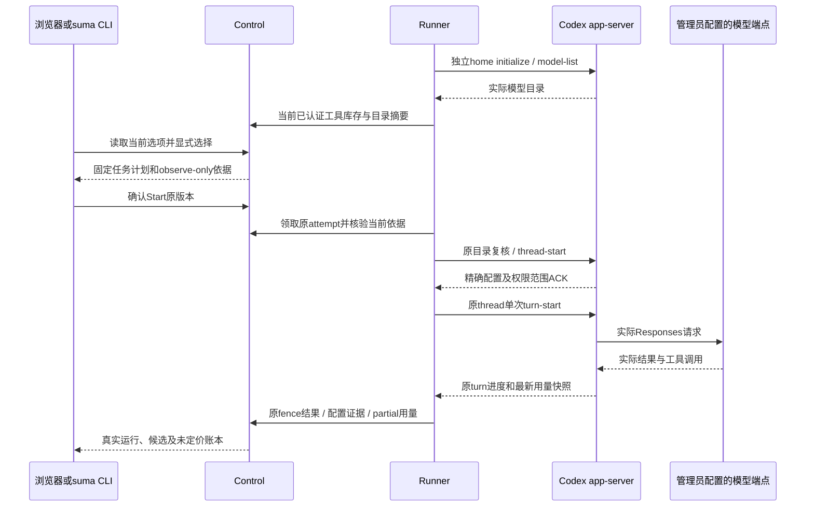

# Codex 实际执行接入与 AI SOP

状态：T-P4-041／1.0.0，限定单任务本地执行已验证。Owner：平台集成。关联需求9、12、14、18、21、22；[共享合同](../../contracts/codex-app-server.md)、[控制面](../../internal/platform/codex_execution.go)、[执行器](../../internal/runner/codex_appserver.go)、[本地配置](../../internal/runner/codex_appserver_config.go)。

## 领域边界

Codex配置确认与原生提供方回执分别建模。`CodexCatalog`／`CodexSelection`／`CodexBinding`／`CodexEvidence` 是模型域的独立合同；公开类型名称保持全局唯一，OpenAPI及TypeScript从Go来源生成。正式任务和DAG状态、执行器输出、候选代码、质量检查、人工验收及发布是独立事实。

配置ACK只证明CLI接受配置；官方Thread类型已明确模型字段是配置而非每轮提供方遥测。rerouted通知保留原事实，缺少通知不证明未发生提供方路由变化。通知总量不能等价于厂商账单。

## 安全与可维护性

本地typed配置优先于任意TOML透传；只生成已支持配置，秘密只来自明确环境引用。独立home、当前工作树根和临时目录均在受管任务目录中。模型端点与凭证引用不允许通过任务字段覆盖。跨层保留同一 `HasNodeOverrides`，避免Control允许而Runner随后拒绝。

Go Runner复用现有进程树、流式输出、Journal和候选封装；只新增双向stdio状态机。CLI原API和models options读取复用现有身份及业务接口。前端复用React、现有组件、设计令牌和持久操作恢复，没有引入第二套界面、权限或预算账本。

## AI 开发 SOP

1. 先确认实际工具协议和本地执行文件摘要；读取安装版生成schema，明确真实支持的字段。帮助或目录探测不能标作编码任务成功。
2. 当前目录及配置形成稳定公开摘要，服务端冻结选择。新增字段须同步Go合同、DAG编译、Control预览／启动／领取、Runner、生成类型及界面。
3. 无法保证的预算用明确能力表达；硬策略必须拒绝，不能沿用原生输入预留计算或按模型配置标签报价。
4. 保留原操作和快照；未知响应不能清key，未知副作用不能新建一次执行来掩盖。取消ACK与实际停止分别记录。
5. 修改后只运行对应边界检查；实际集成使用独立副本、自有端点和明确门禁。新真实调用不得由宽正则或普通套件意外触发。保留原失败，修复后仅重复必要路径。
6. 当前阶段提交源码、合同、设计及精简证据；不提交本地账户、数据库、原始日志、截图、构建产物或依赖缓存。完整平台剩余范围仍按实施计划推进。

最终真实CLI已在独立工作树完成编码、原进度与结果回写以及partial未定价账本。最初目录、ACK及写入失败保持在[验证报告](../quality/codex-app-server-verification.md)，不改写原失败；正式测试、人工验收和生产范围分别记录。

## Windows实际接入依据

真实安装版解析遇到两个已定位差异：受保护祖先目录不可枚举时，统一通过已打开文件的Windows最终路径API核验同一目标；非致命stderr警告不能污染版本stdout。随后实际thread/start返回只读，不能放松写入门禁来通过。Windows本地typed配置必须显式选择原生实现，新的配置摘要包含生成策略版本；工作区cwd隐含根与additional roots按实际ACK分别核验。

官方配置参考明确writable_roots为附加根，并列出Windows实现；实现仍以当前锁定CLI实际证据为准：[官方配置参考](https://learn.chatgpt.com/docs/config-file/config-reference?translationFallback=zh-Hans)、[官方基础配置](https://learn.chatgpt.com/docs/config-file/config-basic?translationFallback=zh-Hans)。没有读取当前用户登录配置、修改机器／用户全局设置或用无隔离模式替代工作区约束。

## Windows运行前提与故障恢复

部署应使用具备创建内层工作区隔离进程条件的正常Runner宿主。本阶段已定位：Codex被另一层受限Windows token启动时，内层CreateRestrictedToken可失败87。遇到此错误保留原attempt失败及已知部分用量；先检查宿主条件，以零模型command/exec定位，不自动切换无隔离模式、不提升任务权限、不修改机器ACL或用户配置。经审阅在正常宿主对照保留相同内层策略后，才重跑必要编码路径。PowerShell受限语言保持有效，不能要求全语言模式来掩盖脚本不兼容。

本地配置显式指定windows_sandbox，执行范围仍受thread ACK核验。管理员应独立验证所选平台原生隔离和网络阻断，配置ACK本身不是OS安全验收。只读目录、无turn ACK、实际编码及生产测试分开记录；其他平台当前没有对应安装运行证据。

停止意图在等待stdout处理锁前发布，统一请求闸门拒停止／已坏／持久化失败后的新RPC；尚无turn ID时关闭输入，迟到ACK不启动首次turn。已提交请求与确认停止仍分别记录。
