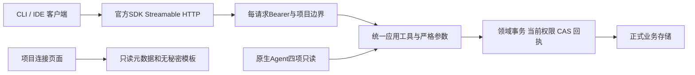

# 项目 MCP 开发工具接入

状态：T-P4-019 本地已实现并验证。负责人：主集成代理、应用工具代理、SDK代理、界面代理。需求：外部CLI／IDE项目协作、统一当前权限、中文与英文、可追溯草稿写入。

## 能力与产品边界

速码通过官方 `github.com/modelcontextprotocol/go-sdk v1.8.0` 提供入站 Streamable HTTP 服务。项目工具直接复用控制面的应用服务、当前权限和正式操作回执。MCP不是另一份业务状态，也不拥有独立派发权。

受控目录共13项：项目概览、任务列表、关键词检索、显式固定知识读取；需求列表、单条需求、单条任务、需求设计、任务设计依据、知识元数据；创建需求草稿、创建待办任务、保存需求设计草稿。Agent令牌只提供前四项；当前有效项目API令牌按权限提供其他项。创建与保存草稿不表示评审通过，不发起执行、不发布知识、不写测试证据、不批准正式验收或部署。

原生 Agent `/agent/tools` 和 `/agent/tools/invoke` 保持原四项只读合同，和MCP复用应用实现。平台现有其他REST接口继续按各自权限合同运行；此处并未给所有REST批准接口增加“仅浏览器”约束。

## 操作步骤

1. 在项目的连接令牌页面选择需要的令牌范围，由有权管理员明确签发。Agent适用于只读上下文，API适用于受控草稿操作。令牌只展示一次，有固定到期时间；签发不等于客户端已连接。
2. 复制页面给出的项目地址和Codex配置模板。地址取自可信服务配置；没有公开地址时先让部署管理员设置 `SUMA_PUBLIC_URL`，页面不会猜测代理的Host。
3. 在运行客户端的进程环境设置 `SUMA_MCP_TOKEN`。不要把令牌写入模板、需求、聊天记录、Git、URL或截图。客户端必须能访问模板中的地址；另一台机器的 `127.0.0.1` 指向该机器本身。
4. 把模板合入客户端的配置并重新建立连接。模板带原账户／组织标识用于防止误写；这些字段没有授权能力。用户或组织变化时，明确核对并重新获取模板。
5. 通过客户端列出工具，再读取项目上下文。写入使用稳定 `idempotency_key`；相同操作的结果未知时重试原输入与原key，不另起一次创建。设计保存还必须带当前设计和需求版本。
6. 回到速码核对真实草稿及版本，再按正式评审／派发流程继续。

Codex字段已由本机CLI帮助及[官方MCP文档](https://learn.chatgpt.com/docs/extend/mcp?surface=cli)核对：`url`、`bearer_token_env_var`、`http_headers`。界面复制的是不含秘密的配置片段；不修改用户的Codex配置，不自动运行模型，不声称具体厂商工具已验收。其他客户端需按其实际协议和认证配置接入。

## 接口、配置与恢复

- 地址：`/api/v1/mcp/projects/{project_id}`。无状态JSON响应，每个HTTP请求重新认证Bearer，工具调用在业务事务内重新核验当前权限。浏览器Cookie、Runner令牌和失效凭证不接受。
- 元数据：`GET /api/v1/developer-connection?project_id=…`。需当前浏览器或API读权限；固定 `client_connection_verified=false`，只提供目录声明与可信地址。
- `SUMA_PUBLIC_URL` 只接受HTTPS源地址；本地HTTP仅接受明确回环主机。禁止用户名、密码、路径、查询及片段。未配置时只在明确回环监听生成本机地址；外部监听不猜测公开入口。
- 原始业务正文、名称、标识、修订SHA和证据保持原值。工具说明与平台诊断按中文／英文显示；其他语言通过统一目录扩展。
- HTTP读写上限、超时、取消、参数Schema、拒绝重复键和原页面身份核对在服务端执行。HTTP传输拒绝与MCP工具错误分别处理；维护模式冻结POST，包括MCP初始化和查询。
- 撤权、过期、撤销、跨项目或缺少原始写入上下文时，即使知道原key，也不能绕过当前授权恢复历史结果。

OAuth自动发现、出站MCP服务器管理、插件执行、A2A、完整IDE与厂商账号验证仍为后续能力。实际证据和限制集中在[阶段验收](../quality/project-mcp-verification.md)。

## 架构与AI SOP

增加工具时，先写清读写效果、允许的凭证种类、版本及幂等合同；再提供严格输入类型和封闭Schema。业务处理必须委托既有领域服务或在单一事务内实施权限、前置条件和效果，不在传输层拼SQL。禁止先读取后无条件更新、用缓存目录代替授权、为幂等增加第二层不一致回执。补充中英文说明和可操作诊断，生成客户端类型与OpenAPI。只运行新增行为及受影响边界的验证；共享依赖或工具链变更在集成里程碑执行一次必要完整后端检查。发布记录区分源码、官方SDK实测、实际客户端厂商和生产环境验收。
