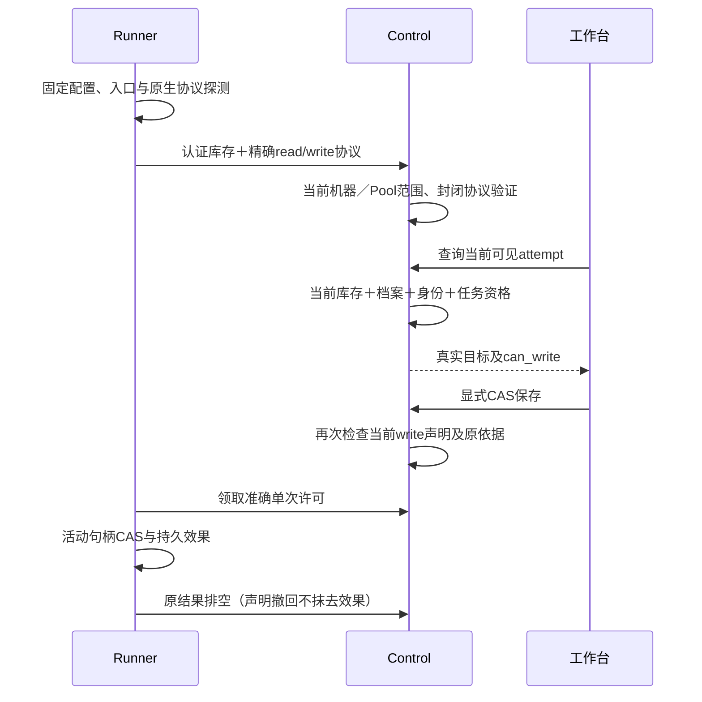

# 当前执行器能力与工具库存接入

状态：T-P4-039／1.0.0。负责人：执行基础设施。关联：[合同](../../contracts/workspace-transport-capabilities.md)、[模型执行](../../contracts/model-execution.md)、[远程保存](../../contracts/workspace-write.md)、[实际验证](../quality/workspace-capability-verification.md)。完整P0–P7和需求1–22仍在实施。

## 产品与架构

用户应能区分“批准了什么”“机器最近支持什么”“现在是否有可操作的执行”。原生工具协议不能代替Runner传输实现。两项broker版本放在当前 `ToolObservation`，批准工具的Profile和摘要保持自身职责；重新上报无需重复批准相同工具。当前观察过期、凭证撤回、任务或工作区失效仍单独阻止执行。

界面默认只增加折叠观察内两行事实，避免额外配置面板。中英文共用生成字段。历史协议保留原值，不能把当时声明渲染成当前健康。原生库存导入接受公开原生、模型和只读用途合同；并不向控制面发送伪造机器观察，只将选中的Profile提交普通审批路径。

## AI SOP

1. 核对实际版本、进程、Web入口、数据目录、当前机器和允许工具。读取当前库存；不要凭配置文件宣称在线。
2. 先把同版本Control、Runner和原生bundle交付到明确位置。保持本地模型密钥及工作目录配置独立，不写入库存或Git。
3. 由原独立机器身份重新上报真实探测。旧库存没有新协议时保持未声明；不改数据库补标记。
4. 用户在工具详情核对最近上报及两项协议。仅read时提供查看，write仍需当前人／任务资格；没有活动attempt时显示空态。
5. 保存失败时先读原命令；效果未知沿038显式核对，不因升级、超时或能力撤回而换key再执行。
6. 更新主预览前做WAL一致备份，保持旧表完整事实和密钥，先克隆迁移；正常模式启动后发生新写入只能前向修复。见[预览升级](../deployment/preview-upgrade.md)。

本阶段主预览交付未自行启动Runner、签发凭证、绑定用户目录或调用模型。已启用工具配置不代表当前机器在线。安装器、服务管理、实体多机/TLS、完整远程IDE和外部CLI独立模型参数仍有后续工作。
