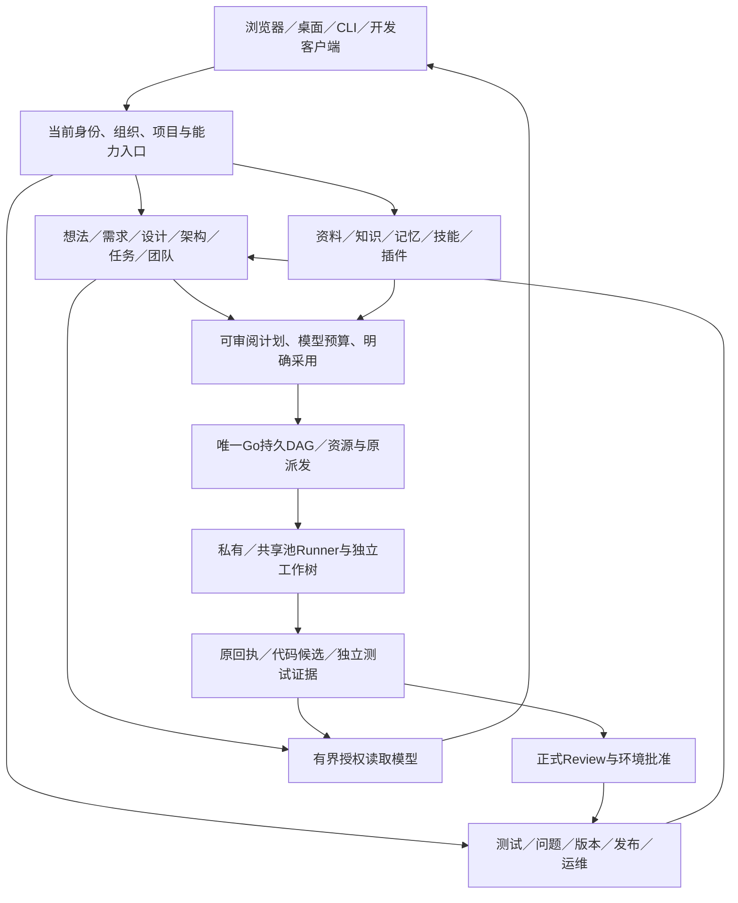

# 企业智能研发工作台：需求与架构深化

状态：T-EXPERIENCE-133，1.0.0；负责人：产品／工作台／控制面。完整产品基线与P0–P7沿[原实施计划](../delivery/implementation-plan.md)，本阶段不缩减为首页或工具目录。本文记录本轮可实现的闭环与后续扩展边界。

## 用户目标与本轮验收

项目负责人进入首页后，先看需要规划、执行、验收或处理的真实任务；一键进入原任务详情。开发者选用现有客户端，获取明确项目范围、身份校验和令牌环境变量的接入配置。团队管理员继续在平台管理工具档案、节点、模型、预算和原派发；客户端接入本身不扩大授权。

本轮实现[项目焦点合同](../../contracts/project-focus.md)及[开发客户端接入](../integrations/developer-clients.md)。准确总数与有界明细来自服务端；不把列表首批条数当项目全量。运行成功和正式验收分别展示。配置导出没有实际厂商连接／执行证据时，保留“尚未验证连接”。

## 领域模块及统一管控

| 边界 | 当前复用 | 扩展规则 |
| --- | --- | --- |
| 人／组织／团队／菜单权限 | 现有账户、角色、项目授权及管理工作区 | 新业务复用同一服务端权限，不以隐藏按钮代替授权 |
| AI与工具 | 模型网关、费率／预算、固定工具档案、现有适配器、MCP能力目录 | 区分平台能力连接与可管理执行；新CLI须补取消、回执、费用和恢复合同 |
| 调度与协作 | Go DAG、原attempt／fence、队列、共享池、原事件／Outbox | 不给客户端、专家或插件第二套派发／验收权 |
| 知识与自动化 | 当前资料、检索、记忆和建议／采用流程 | 来源权限重新校验；提案、正式规范、批准和执行分别保留 |
| 数据与部署 | SQLite本机、OceanBase团队目标、现有制品及多模态接口 | 单机／私有／分布式复用相同身份及执行合同，分别取得恢复与规模证据 |
| 视图与配置 | 原领域页面、统一设计令牌、中英目录、版本与原操作ID | 从读取事实下钻，不为图表另建状态；新配置说明作用域、默认值和启用条件 |

## 工作流及自动化边界

想法转为可编辑需求／设计计划，明确采用后拆解任务；任务选择人、智能体、专家团队或固定工具，并冻结需求、代码、模型与预算。派发诊断说明真实等待原因；执行、测试、验收及发布分别跟进。失败或退回保留原证据并回流问题／需求，新任务采用精确已验收基线继续开发。

AI可提出拆解、调度、诊断或优化建议，不能因建议可信度高就省略原授权和质量门禁。审批、未知效果核对、生产环境操作以及预算变更仍沿既有明确操作。本轮首页不自动发起模型调用、远程安装、探测或执行。

## 体验与后续交付

首页保留并发合入的全量验收进度、分页关注队列、里程碑、团队、应用和运行入口；任务计划与执行依据是默认收起的按需诊断，不重复主要待办或默认请求。错误区域提供本域重试；切换项目清除旧筛选与迟到响应；未知值保持未知。客户端导出按项目命名，预览配置并明确复制／下载失败后的手动路径，不写入用户IDE配置文件。

Cursor、Claude Code、Codex与OpenCode本轮提供已核对格式的配置片段；Qoder、Zed、WorkBuddy及Harness只在具备确切可证明配置方式后提供同等导出。所有客户端的完整产品功能、商业账户、厂商CLI自主开发、物理多机、高并发、三系统安装及生产验收仍按原台账推进。源码、组件、真实服务、真实厂商和生产的证据等级分别记录。
