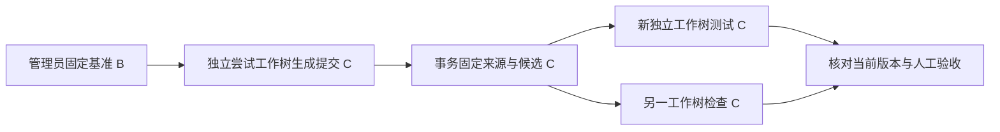

# 固定候选代码交接与验收

状态：已实现并完成本机 SQLite、真实 Runner 与浏览器纵向验证。负责人：调度与平台集成。关联：P2 独立工作树、P3 任务验收。接口：`Workflow.Node.config.candidate_from`、`Assignment.candidate_*`、`POST /runner/results`。实现：`internal/dag/candidate.go`、`internal/runner/workspace.go`、`internal/platform/workspace_evidence.go`。

## 明确的代码输入

一个测试节点可以指定本流程中一个静态 `command` 或 `agent` 祖先为候选来源。来源必须同时位于已发布的依赖图中；仅填写节点名不会产生隐藏依赖。界面通过“上游依赖”和“测试候选来源”完成配置。工作流作者不能填写执行信封中的提交或来源证据字段。

来源的当前尝试必须成功、效果已知、工作树干净，且具有完整 Git 提交和证据摘要。未提交的补丁不能被当作可交接代码。即使测试通过任一成功汇合提前就绪，候选来源尚未终结时仍等待，不领取执行槽位；来源终结但缺少合格证据时明确失败。

## 冻结与派发

领取事务在 `dag_candidate_revisions` 保存运行、测试节点、测试 attempt、候选提交、来源节点、来源 attempt、来源 fence 和来源证据 SHA-256，随后记录 `candidate_pinned` 事件。该记录与派发状态、资源预留及 attempt 同事务提交。

Runner 收到的五个顶层字段为 `candidate_commit`、`candidate_from`、`candidate_attempt`、`candidate_fence`、`candidate_evidence_sha256`。普通节点配置不能覆盖它们。重试生成新的 attempt 和固定记录，原失败、输出及证据保留。

## 执行边界

Runner 只在管理员配置的仓库内解析候选对象，验证管理员基准是候选的祖先，再创建新的 detached 工作树。候选测试使用管理员标记 `test_evidence:true` 的许可命令；不可变构建消费需管理员明确的制品构建能力。执行仍使用独立工作树，拒绝共享只读工作区。没有自动 fetch、合并或重置用户工作区。

T-P4-018已加入[跨节点候选传递](../architecture/candidate-transfer.md)：在控制面与Runner同版且已配置当前权限时，本地缺少固定候选可读取对应封存Git bundle，经摘要、前置对象与strict对象校验后导入。已有对象不重复下载；没有合法包、共同基线或当前权限时明确失败，保持准备失败、停止及效果未知回执。多分支合并、跨map或子流程的自动交接继续待实现。

Windows 执行环境只传递明确的普通运行变量及管理员许可的额外变量，不复制整份环境。名称按 Windows 规则处理大小写；冲突别名被拒绝。TEMP/TMP 仅指向本次尝试目录，未知父进程秘密不自动进入子进程。真实 PowerShell→Git 验证曾暴露缺少 SystemDrive/PATHEXT 的错误，修复后同一许可配置通过，失败证据仍保留。

## 完成和验收

成功测试回执必须证明 `base_commit = head_commit = 固定候选`，工作树干净、管理员测试标记为真，并逐项匹配已冻结的来源身份与证据摘要。`Stopped:true` 不能绕过成功结果校验；取消期间的未知外部效果保持 `reconciling`。

包含代码生产节点的任务验收要求每个已选代码与测试节点具备明确工作树证据，且每个候选提交被本次运行的测试覆盖。测试命令声明与 `test` 节点类型同时检查。没有代码工作树的纯测试运行只表达非代码测试事实，不能代替代码交付、制品测试或合并证据。合并仍只有预检，未执行自动合并。

审批权限在读取原验收回执和正式写入时分别于组织锁内复核，再取得调度锁；撤成 viewer 的旧评审者无法继续验收或重放原特权响应。任务、需求、依赖和运行版本变化仍使用既有证据失效规则。

## 证据

- [真实候选浏览器截图](../quality/evidence/candidate-test-1920.png)
- [真实人工验收](../quality/evidence/candidate-human-acceptance.png)
- [候选及权限独立复核](../quality/candidate-authority-review.md)
- [Runner Windows 环境实际执行](../quality/evidence/runner-windows-environment-execute.json)

本机验证不证明分布式数据库、生产发布、厂商智能体账户、自动合并或规模指标已经通过。
