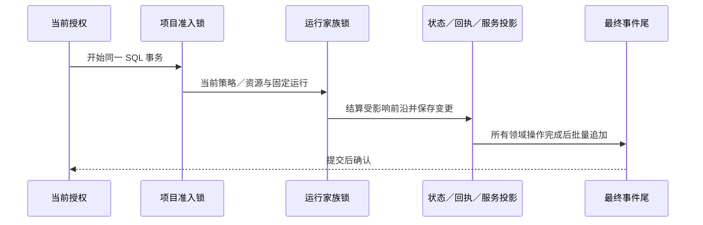

# 持久化增量调度内核

状态：1.0.0 初始化基线，本机 SQLite 实现与限定验证；负责人：Core 代理／主集成代理。关联需求：持久就绪队列、调度准入、恢复、可解释阻塞。共享合同：[scheduling-kernel](../../contracts/scheduling-kernel.md)，实现：`internal/dag/scheduling_*.go`，接口类型：`internal/dag/scheduling_types.go`。

## 事务与持久状态

运行固定流程版本。编译采用邻接表与拓扑检查；每次运行保存邻接边、条件观察关系、边结算、节点依赖计数及运行计数。完成节点只结算直接后继、显式条件观察者和映射父节点。热路径按需读取相关节点，不载入完整工作流后扫描全部节点。保存比较实际持久字段，仅写变更节点。

| 持久记录 | 用途 |
|---|---|
| `dag_graph_edges`、`dag_condition_watchers` | 直接依赖与显式条件依赖 |
| `dag_edge_resolutions`、`dag_node_dependencies` | 代际、来源 attempt/fence、已解析／选中／成功计数 |
| `dag_node_work`、`dag_run_counters` | 有界推进前沿与终态计数 |
| `dag_ready`、`dag_scheduler_run_turns` | 正式就绪记录、项目内运行轮转 |
| `dag_claim_run_scans`、`dag_dispatches` | 有界候选扫描进度、含空结果的领取回执 |
| `dag_wakeups` | 定时、重试、租约、展开及传播唤醒 |
| `dag_wake_retries` | 原唤醒身份下的失败次数和下次调度时间 |
| `dag_join_decisions` | 任一成功／阈值汇合的冻结获胜集合 |
| `dag_map_expansions`、`dag_map_progress` | 固定清单与摘要、展开边界和子节点结算 |
| `dag_scheduling_policies`、`dag_resource_accounts`、`dag_resource_ledger` | 策略 CAS、当前准入计数、每 attempt 的持有／累计收费 |
| `dag_retry_windows` | 每次显式恢复代际的总截止与自动重试序列 |

写事务锁顺序为组织／凭证当前授权、项目、root run 家族、领域记录、事件尾。Core 库自行取得项目和家族锁；控制面在同一事务先核验当前授权。`GuardProjectTx` 让控制面的候选、验收及发布操作加入相同项目锁。SQLite 使用写事务互斥；OceanBase／PostgreSQL 写事务使用 Read Committed，变更路径的策略与资源采用当前锁定读取、版本条件和受影响行数检查。后两种数据库尚需真实服务验收。

事件先在事务内暂存。领域、父子传播、服务提交 hook、操作回执全部完成后，才在最终尾部短暂锁定 `dag_lock`，批量取得序号并追加事件，随后只提交。正式状态、事件、回执不会分开成功。全局游标保持原语义；组织授权锁仍会串行化同组织操作，不能据此声称完成全平台分片或跨组织公平。

## 有界派发与等待

每次领取最多访问 16 个索引中的运行头、返回 64 个能力匹配候选进行资格、候选代码及资源核验。未派发的扫描位置持久化，下次新操作接着扫描；成功派发后重新从最少被服务的运行考虑。该边界约束应用候选数，不等于数据库内部索引页访问数。能力不匹配由 SQL 预筛，当前工具／发布资格在事务中再次核验，失败不建立 attempt、不扣准入单位、不增加已服务份额。

领取操作固定 worker 与规范化能力摘要。相同操作恢复同一派发，空结果也固定。恢复活跃派发时再次检查当前授权与资格；暂停或撤销工具不能靠丢 ACK 回放绕过。观察到 `closed` 或 `reconciling` 的派发不能启动进程。租约到期进入核对，保留原 attempt/fence，不能猜测“未执行”后重新派发。

`TickBatch` 默认读取最多 100 个到期唤醒，上限 1,000；按运行分别提交，某个损坏运行不会回滚其它运行。每次 recheck 唤醒代际、attempt、fence、到期时间和状态。暂停后的非租约唤醒停止轮询，不因周期 Tick 增加运行版本；恢复重新启用并处理已经到期的工作。传播每事务最多处理 2,048 个前沿条目，余项保存唤醒。等待、审批、映射父节点和子流程容器不占 worker 额度。

唤醒处理事务失败时，控制面在独立事务中核对原唤醒身份和重试状态，然后把仍有效的唤醒转入持久退避。原到期时间、节点代次、尝试与 fence 保留。以数据库时间计算 5、10、20、40、60 秒退避，持续失败时上限 60 秒。读取按各自索引限制新到期与退避到期候选，再按可处理时间合并。成功消费、转入暂停或替换原唤醒时清理退避记录。 [阶段验证](../quality/wake-and-scan-recovery-verification.md)

`GetRun`、事件、策略、队列、节点准入及尝试读取不推进状态。完整运行接口可载入完整图；精确 attempt 深链无需首页已包含该记录。尝试列表只读取持久元数据，来源为 `not_loaded`；完整结果在详情按需读取。人工核对返回 `manual_reconciliation` 与理由，不伪造 Runner 成功或零用量；受控提供方核对为 `managed_observation`，原未知结果仍保存在独立核对记录。

## 依赖、展开与重试

全部运行使用统一依赖语义：默认汇合等全部入边解析，只要求已选必需分支成功；全部未选则跳过。显式 `skipped`／`all_done` 边仍可选择被跳过结果。`any_success`／`quorum` 在首次满足阈值时持久冻结来源，后续兄弟完成不改获胜集合；运行最终仍等待独立分支终结，未处理失败不会被清理成功覆盖。

映射先保存完整输入、模板与二者 SHA-256，再以稳定 `map_id[index]` 创建每批最多 128 个子节点。子节点与 `next_index` 的 CAS 边界在同一事务，崩溃不会留下部分已提交但边界未前进的批次。展开未关闭时父节点不能完成；0 项关闭为空结果。重启通过持久展开唤醒补齐。单映射上限 1,000，编译校验包含子流程展开的总图上限 10,000。

新 worker 自动重试要求 `idempotent=true` 且机器结果明确 `failure_class=transient`，最多两次，退避为 1、2 个数据库秒。未知效果、协议失败、永久失败和缺分类均不自动重试。无确切瞬时来源的失败子流程也不猜测自动重试。`timeout_seconds` 为本次执行序列总窗口，未配为 300 秒；首次派发固定窗口，后续 attempt、领取回放和心跳只能使用剩余时间。显式人工重试创建新代际窗口，旧窗口和全部尝试保留。时长上限 9,223,372,036 秒来自 Go 纳秒时长表达边界，不是业务配额。

## 配额、资源与真实范围

项目未持久化策略读作 version 0／default；创建运行或领取时确保正式 version 1，默认执行槽位为 1。每个 worker attempt 至少预留 1 execution slot、累计消耗 1 admission unit。节点显式请求 0 会在新编译拒绝；持久定义中的 0 也不能绕过实际零预算。容量 0 阻止新派发，`null` 表示相应可选资源／累计预算不限。

准入先检查全部请求，再用当前计数、版本条件及受影响行数原子预留；最后一个额度不能由两个连接各自花一次。策略 `budget_spent` 和 budget account 必须一致，否则整笔准入回滚。预算即使不限也记录累计已发生单位，不退款。它不是金额、token 或已测硬件负载。

进程类为 `execution_slots/cpu_millis/memory_bytes/gpu_slots`；模型并发及自定义资源归效果类。确认进程停止但效果未知时只释放进程类，效果类保留至核对。已知终态释放所有并发类；累计预算不释放。界面应将配置容量、当前请求／持有和未知事实分别显示。

当前公平范围是同项目的运行轮转。跨租户／项目加权池、OS 实际硬限制、模型速率限制和真实结算尚未由本内核完成。

## 初始化与正常重启

1.0.0仅建立当前持久表、索引和schema声明，调度只有一份ready队列及一套资源账本。初始化检查整个dag_命名空间；已有未声明领域表时拒绝启动，不读取旧队列推断运行、不回填分代、不补写预算，也不删除原数据库。

当前schema声明先于幂等DDL，允许同版安装中断后继续初始化；声明不代表服务就绪或生产验收。正常重启复用原运行、固定路由、attempt/fence、资源账本、依赖计数与唤醒。缺少应已持久化的图／计数／路由视为不完整事实，明确失败，不推断私有路由或静默重建。

## 验证与限制

回归入口为[增量与唤醒](../../internal/dag/scheduling_incremental_test.go)、[准入与领取](../../internal/dag/scheduling_admission_test.go)、[重试窗口](../../internal/dag/scheduling_retry_test.go)、[旧数据迁移](../../internal/dag/scheduling_restart_test.go)及[真实驱动计数和基准](../../internal/dag/scheduling_benchmark_test.go)。计数记录实际SQL调用、返回行与受影响行，不计数据库内部页访问或隐式语句，也不将单次机器耗时作为唯一通过条件。

本域完整回归为91个顶层用例、含子用例123个pass事件，0失败／0跳过。已完成1,000节点／2,994边本机SQLite样本；冷启动建立持久账本，短链开销可能增加，热路径收益与冷启动成本分开披露。结果和复现方式见[阶段验证摘要](../quality/scheduling-verification.md)及[机器可读摘要](../quality/scheduling-summary.json)。

原始RED、GREEN、基准和源码摘要保留本地 `.cache/e2e/scheduling-stage/` 与 `docs/quality/evidence/scheduling-core/`，不随源码提交。千槽位、千事件每秒、跨组织公平和OceanBase／PostgreSQL实际运行仍需独立验证，不能由本机样本推导生产通过。
